# Atlas: complete data, publication, plot and metric reference

> A reader's guide to what Atlas collects, calculates and publishes for Debrecen, Hungary. This is not an installation guide, a forecast or a description of proposed future features.

Reviewed on **15 October 2026** against the implementation at `a5da258`, and updated on **18 October 2026** for the published archive's satellite cadence, its retention-aware capacity forecast, the JPEG link-preview cards and the syndication products. Dates, thresholds and defaults below describe that implementation. This document does not claim that a particular weather value is today's latest observation.

[Open Atlas](https://danebencedavid.github.io/Atlas/) · [Daily report](https://danebencedavid.github.io/Atlas/report.html) · [72-hour analysis](https://danebencedavid.github.io/Atlas/analysis/) · [Saved editions](https://danebencedavid.github.io/Atlas/archive/)

## Contents

1. [What Atlas is](#1-what-atlas-is)
2. [Geography, reporting periods and evidence types](#2-geography-reporting-periods-and-evidence-types)
3. [The complete data-source inventory](#3-the-complete-data-source-inventory)
4. [Every publication page](#4-every-publication-page)
5. [How to read the example figures](#5-how-to-read-the-example-figures)
6. [Complete plot catalogue: all 27 generated figures](#6-complete-plot-catalogue-all-27-generated-figures)
7. [Surface-weather and climate metrics](#7-surface-weather-and-climate-metrics)
8. [Weather events and frontal passages](#8-weather-events-and-frontal-passages)
9. [Atmospheric, storm and transport diagnostics](#9-atmospheric-storm-and-transport-diagnostics)
10. [Land, water balance and renewable energy](#10-land-water-balance-and-renewable-energy)
11. [All six activity lenses and every scoring rule](#11-all-six-activity-lenses-and-every-scoring-rule)
12. [Electricity-system metrics](#12-electricity-system-metrics)
13. [Historical summaries, records, regimes and analogs](#13-historical-summaries-records-regimes-and-analogs)
14. [Weather Story graph and supporting tables](#14-weather-story-graph-and-supporting-tables)
15. [Downloadable evidence and machine-readable products](#15-downloadable-evidence-and-machine-readable-products)
16. [Completeness, withholding, recovery and corrections](#16-completeness-withholding-recovery-and-corrections)
17. [Archives, preservation and automatic retention](#17-archives-preservation-and-automatic-retention)
18. [Attribution, limitations and terminology](#18-attribution-limitations-and-terminology)
19. [Reference map and example provenance](#19-reference-map-and-example-provenance)

## 1. What Atlas is

Atlas is a retrospective weather publication focused on Debrecen. It combines surface observations, gridded weather, radar, lightning, satellite images, pressure-level model fields and historical climate comparisons into an account of completed weather periods.

The main questions are:

- What happened yesterday, and how did it unfold hour by hour?
- What atmospheric setup shaped the last three complete days?
- Were temperature, rainfall, wind, pressure, cloud and radiation unusual for the calendar period?
- Was there evidence of fog, frost, heat, strong gusts, heavy rain, thunderstorms or a frontal passage?
- What was happening through the atmospheric column, not just near the ground?
- Where might the arriving air have travelled from?
- How did weather translate into reference solar and wind output, atmospheric drying demand and soil conditions?
- How does the local weather chronology compare with Hungary's electricity system?

Atlas is **not** an operational forecast, warning service, official climate-record authority, agricultural prescription, health assessment or power-plant production forecast. A diagnostic labelled “heat stress” or “convective” is an Atlas threshold classification, not an official alert.

The publication is deterministic: reported classifications, activity scores, event candidates and narrative components follow explicit calculations and rules. The Weather Story is an evidence-linked interpretation, not a causal model fitted to prove why an event happened.

## 2. Geography, reporting periods and evidence types

### 2.1 Geographic scope

| Product | Geographic meaning |
| --- | --- |
| Main location | Debrecen, Hungary; configured point 47.5316° N, 21.6273° E |
| Official surface ledger | HungaroMet Debrecen Airport, station **64711**; a specific observing site, not an average of the entire city |
| Continuous surface and climate series | Open-Meteo gridded values requested near the configured Debrecen point |
| Radar reconstruction | Composite radar neighbourhood configured with a **140 km** radius around Debrecen |
| Lightning diary | Events within **150 km** of Debrecen, selected by great-circle distance |
| Synoptic animation | Central Europe: **44–51° N, 16–26° E**, sampled on a **1°** grid |
| Air-mass trajectory wind field | Wider domain: **34–62° N, 10° W–40° E**, sampled on a **3°** grid |
| Electricity | **Hungary-wide** generation, load, prices and cross-border flows; not Debrecen metering |

The requested grid spacing is not a claim about the native resolution of a provider's underlying model. Regional fields provide context for Debrecen; Atlas does not turn them into direct local observations.

### 2.2 Time windows

All report dates refer to the **Europe/Budapest** local calendar. Timestamps are handled in UTC internally and converted for local reporting.

- The daily public report covers the final complete local day of the selected period.
- The expert analysis covers three complete local calendar days, conventionally called “72 hours.” A daylight-saving transition can make that window 71 or 73 elapsed hours.
- The context diary normally covers seven local days ending on the report's final day. If that context cannot pass its checks, the active report period can be shown instead, with a quality note.
- Land-surface context normally covers the preceding 90 days.
- The selected atmospheric profile is nearest **12:00 UTC on the final report day**. It is one time slice, not an average of the whole analysis.
- Synoptic frames are sampled every six hours; satellite frames approximately every three hours; radar replay normally hourly, with a separate half-hourly accumulation sampling.

A normal local day has 24 hourly samples and 144 ten-minute station timestamps. A spring clock-change day has 23 hours/138 ten-minute timestamps; an autumn clock-change day has 25 hours/150 timestamps. Coverage denominators follow those actual boundaries.

If the newest candidate period is incomplete, the publisher can look backward by up to seven days for a supported period. Consequently, “latest” means the latest **publishable** period selected by the checks, not an unconditional promise of yesterday. Always read the displayed date.

### 2.3 Evidence categories

| Label | Meaning | Examples |
| --- | --- | --- |
| Observed | Direct instrument records | Airport temperature, pressure, visibility, rain and gusts |
| Remote-sensed | Evidence inferred from radar, lightning detection or satellite instruments | Reflectivity, LINET events, MSG imagery |
| Model-derived | Gridded model/reanalysis quantities or diagnostics calculated from them | Pressure-level profile, soil moisture, synoptic fields |
| Derived | Atlas calculations, summaries or classifications | Anomalies, event candidates, trajectories, reference yields and activity scores |

“Derived” does not necessarily mean “derived from observations.” A reference turbine calculation is derived from gridded wind. Similarly, a node's position in the Weather Story does not establish its instrument provenance: read its source text.

## 3. The complete data-source inventory

### 3.1 HungaroMet station observations

The ten-minute ODP station export provides these fields:

| Atlas field | Quantity | Unit |
| --- | --- | --- |
| `time` | Observation timestamp | UTC timestamp |
| `station_id` | Station identity | Identifier |
| `temperature_c` | Air temperature | °C |
| `relative_humidity_pct` | Relative humidity | % |
| `precipitation_mm` | Precipitation accumulation reported for the source interval | mm |
| `visibility_m` | Horizontal visibility | m |
| `pressure_msl_hpa` | Mean sea-level pressure | hPa |
| `wind_speed_ms` | Wind speed | m/s |
| `wind_direction_deg` | Meteorological direction, where wind comes **from** | Degrees clockwise from north |
| `wind_gust_ms` | Gust speed | m/s |

Source sentinel values at or below −999 are treated as missing. The source is clipped to the local reporting window rather than accepting every row in the rolling export.

Hourly comparison/event inputs are calculated from the ten-minute ledger. Temperature, pressure, humidity and ordinary speed fields are averaged; precipitation is summed; gusts take the maximum. Dew point is calculated from each source temperature/humidity pair using a Magnus relation and then averaged hourly. Wind direction uses mean eastward/northward components, equivalent to a speed-weighted circular mean.

This matters near north: an arithmetic mean of 359° and 1° would suggest southerly flow, whereas the vector calculation correctly remains near north. Do not assume every downstream diagnostic repeats exactly the same aggregation: the separate frontal detector has its own hourly processing.

Source: [HungaroMet ten-minute observations](https://odp.met.hu/climate/observations_hungary/10_minutes/). **Forrás: HungaroMet Nonprofit Zrt.**

### 3.2 HungaroMet radar

Atlas reads the 1 km national composite reflectivity NetCDF product. The packed reflectivity conversion is:

```text
dBZ = unsigned packed value / 2 − 32
```

The radar products are:

- time-stamped reflectivity grids for replay;
- a sampled Debrecen-nearest-pixel reflectivity series;
- domain-maximum reflectivity;
- a finite-echo fraction of the sampled source domain;
- a radar-derived precipitation accumulation grid;
- detected convective-cell tracks and intensity-class areas.

Source frames are sampled at 30-minute intervals for the accumulation calculation. The configured archive display stride is three; the radar plotting function samples its input grid by another factor of two. Therefore the illustrated raster is coarser than the original 1 km source. The accumulation is calculated **before** display downsampling.

The accumulation is not an official gauge-adjusted rainfall product. It uses a fixed reflectivity/rain-rate relation and available sampled frames. Missing frames, bright band, attenuation, beam geometry, clutter and anomalous propagation can all affect it.

Source: [HungaroMet radar composites](https://odp.met.hu/weather/radar/composite/). **Forrás: HungaroMet Nonprofit Zrt.**

### 3.3 HungaroMet LINET lightning

The lightning catalogue retains event time, latitude, longitude, source height in km, event-type code, signed peak current in kA, source location-error field and calculated distance from Debrecen. Atlas preserves the provider's event-type and quality values rather than inventing a new classification for them.

Events are filtered to the report window and 150 km radius, then counted hourly. The internal hourly count column is named `flash_count`, but the public interpretation is **catalogued LINET events**: it is not an independently deduplicated count of physical flashes or a lightning-area product.

A successful file with no in-range events is different from an unavailable file. Partial daily-file failures are disclosed in notes. A zero count is not a measure of source coverage.

Source: [HungaroMet lightning archive](https://odp.met.hu/weather/lightning/). **Forrás: HungaroMet Nonprofit Zrt.**

### 3.4 HungaroMet Meteosat imagery

Five MSG products are selected from provider listings:

| Saved product | Reader-facing role |
| --- | --- |
| `AirmassRGB` | Air-mass and large-scale cloud-pattern context |
| `NaturalRGB` | Natural-colour view of daytime cloud and surface patterns |
| `NightRGB` | Night-microphysics context for nighttime cloud structure |
| `FogRGB` | Fog/low-cloud diagnostic imagery |
| `InfraCloud` | Infrared cloud-pattern context, including outside daylight hours |

These are provider images, not Atlas retrievals of cloud-top height, fog probability or pixel-level surface temperature. Atlas samples approximately every 180 minutes, resizes images wider than 960 pixels and stores WebP copies at configured quality 72. Compression and sampling are modifications to the presentation, not new meteorological measurements.

The diary synchronizes the satellite timestamp with nearby radar/lightning evidence in **time**. It does not spatially overlay, georeference or reproject those products onto the satellite image.

Source: [HungaroMet MSG products](https://odp.met.hu/weather/satellite/MSG/). **Forrás: HungaroMet Nonprofit Zrt.**

### 3.5 Open-Meteo continuous hourly surface and land fields

The Historical Weather API supplies the following requested hourly variables. The current record is the provider's best-match gridded product; it is not pinned to fixed ERA5 simply because a page or comparison uses the shorthand “reanalysis.”

| Variable | Meaning | Unit used in Atlas |
| --- | --- | --- |
| `temperature_2m` | Air temperature near 2 m | °C |
| `dew_point_2m` | Dew point near 2 m | °C |
| `relative_humidity_2m` | Relative humidity near 2 m | % |
| `precipitation` | Total precipitation over the hourly interval | mm |
| `rain` | Rain component | mm |
| `snowfall` | Snowfall amount | cm |
| `cloud_cover` | Total cloud fraction | % |
| `pressure_msl` | Mean sea-level pressure | hPa |
| `wind_speed_10m` | Wind speed at 10 m | m/s |
| `wind_speed_100m` | Wind speed at 100 m | m/s |
| `wind_direction_10m` | Direction from which 10 m wind blows | Degrees |
| `wind_gusts_10m` | 10 m gust | m/s |
| `shortwave_radiation` | Global horizontal shortwave irradiance | W/m² |
| `direct_radiation` | Direct radiation on the horizontal plane | W/m² |
| `diffuse_radiation` | Diffuse horizontal radiation | W/m² |
| `sunshine_duration` | Sunshine duration within the interval | Seconds |
| `vapour_pressure_deficit` | Atmospheric vapour-pressure deficit | kPa |
| `et0_fao_evapotranspiration` | FAO-56 reference evapotranspiration | mm |
| `soil_temperature_0_to_7cm` | Soil temperature, 0–7 cm layer | °C |
| `soil_temperature_7_to_28cm` | Soil temperature, 7–28 cm layer | °C |
| `soil_temperature_28_to_100cm` | Soil temperature, 28–100 cm layer | °C |
| `soil_temperature_100_to_255cm` | Soil temperature, 100–255 cm layer | °C |
| `soil_moisture_0_to_7cm` | Volumetric water content, 0–7 cm | m³/m³ |
| `soil_moisture_7_to_28cm` | Volumetric water content, 7–28 cm | m³/m³ |
| `soil_moisture_28_to_100cm` | Volumetric water content, 28–100 cm | m³/m³ |
| `soil_moisture_100_to_255cm` | Volumetric water content, 100–255 cm | m³/m³ |

These fields support the active period, daily slice, seven-day diary and 90-day land context. A soil value is a gridded model estimate, not a probe installed in a Debrecen garden.

Source: [Open-Meteo Historical Weather API](https://open-meteo.com/en/docs/historical-weather-api).

### 3.6 Fixed ERA5 climate archive

The climate archive explicitly requests **ERA5**, beginning in **1990** and ending with the year before the report period. For a report in 2026, that means completed years 1990–2025, not all available ERA5 history since the twentieth century.

Its daily variables are mean temperature, total precipitation, mean 100 m and 10 m wind, mean pressure, mean cloud, total shortwave radiation and total reference ET0. These feed:

- 1991–2020 same-calendar standard-normal comparisons;
- the separate previous-ten-year comparison;
- full-record same-calendar empirical percentiles;
- 7-, 30- and 90-day water-balance reference samples;
- month/season summaries and the record book.

Daily shortwave totals arrive in MJ/m² and are converted to Wh/m² using approximately **277.7778 Wh per MJ**. The 15-year analog search uses a separate daily ERA5 selection and 10 m wind.

### 3.7 Open-Meteo historical-model atmospheric fields

The Historical Forecast API supplies archived model fields. Its name does not make the Atlas publication a forecast; Atlas uses fields for completed periods, and labels the result model-derived.

The local pressure-level request includes **1000, 950, 925, 850, 800, 700, 600, 500, 400, 300, 250 and 200 hPa**. Each level supplies temperature, relative humidity, wind speed, wind direction and geopotential height. Dew point is derived from temperature and humidity.

The accompanying hourly column series requests model CAPE, convective inhibition, freezing-level height, boundary-layer height, total-column integrated water vapour and 2 m wet-bulb temperature.

The regional synoptic request adds mean sea-level pressure; 500/300 hPa heights; 850 hPa temperature, humidity and wind; 500/300 hPa winds; and 700 hPa humidity and vertical velocity. Atlas derives vorticity, thermal advection, approximate equivalent potential temperature and a kinematic frontogenesis diagnostic from those fields.

The wide-domain trajectory request uses 850 hPa wind and temperature for transport reconstruction. It is separate from the smaller synoptic map domain.

Source: [Open-Meteo Historical Forecast API](https://open-meteo.com/en/docs/historical-forecast-api).

### 3.8 Energy-Charts electricity inputs

Atlas requests public Hungary power-system data: generation by source category, system load, residual load, renewable-share series where provided, HU day-ahead prices and cross-border physical flows.

Generation categories are retained when the provider supplies them, not restricted to categories currently drawn on the overview chart. Solar, onshore wind, offshore wind, load and residual load receive explicit canonical column names; other supplied production types become `generation_<type>_mw` columns. A missing category is not proof that the corresponding physical generation was zero.

Cross-border country series are retained in GW; their sum is converted to the `net_import_mw` series in MW. The sign follows the ingested provider convention. Values are national system context, not readings from a local power plant.

Source: [Energy-Charts API, Fraunhofer ISE](https://api.energy-charts.info/). The project identifies ENTSO-E as an important underlying source of European system data.

### 3.9 Sources mentioned for comparison but not ingested into the default publication

NASA POWER and NOAA's Integrated Global Radiosonde Archive are identified in the project notes as possible independent checks. They are not blended into the current products. Atlas does not publish an observed Debrecen radiosonde simply because its profile resembles a sounding diagram. Direct ENTSO-E ingestion is not the default electricity route; the implemented route is Energy-Charts.

## 4. Every publication page

Paths below are relative to the public Atlas site. Saved editions can use `index.html` in place of the live daily `report.html` route.

| Page | What the reader finds |
| --- | --- |
| `index.html` | Project overview; links to daily, expert and archive publications; evidence categories and scope |
| `report.html` | Daily headline and regime; airport mean temperature, rain and peak gust; reference PV yield, wind full-load hours and combined score; six activity lenses; daily meteogram |
| `weather.html` | Daily surface-weather account and the daily meteogram; observed airport summary distinguished from the gridded timeline |
| `events.html` | Daily chronology filtered from the detected phenomena ledger, with timing, evidence and sources |
| `energy.html` | Daily reference PV/wind yields and their hourly/cumulative figure |
| `context.html` | Seven-day weather diary and daily standard/recent/full-record climate comparison |
| `methods.html` | Daily publication scope, evidence distinctions and climate-reference explanation |
| `analysis/index.html` | 72-hour regime and briefing; reference yields and combined score; annotated meteogram; airport, storm, profile and analog highlights |
| `analysis/story.html` | Weather Story graph linking regime, surface weather, thermal character, events, fronts, boundary layer, land and renewable consequences |
| `analysis/surface-synoptic.html` | Station/grid comparison, synoptic animation, wind rose, pressure tendency, back-trajectory and air-mass-origin ledger |
| `analysis/storms-satellite.html` | Satellite/radar/lightning diary, phenomena strip and ledger, radar replay/accumulation, cell tracking and lightning map/counts |
| `analysis/upper-air.html` | Skew-T, selected-profile diagnostic cells, hodograph, storm-relative parameters, column evolution and time-pressure curtain |
| `analysis/climate.html` | Three climate references, five seasonal analogs where available, seven-day diary, anomaly structure, daily regimes and solar diurnal curves |
| `analysis/land-energy.html` | 90-day soil/VPD/water balance; physical PV/wind yields; Hungary electricity overview and weather/electricity scatter plots |
| `analysis/methods.html` | Climate-reference ledger, classification signals, source/quality notes, observational coverage, station verification and data downloads |
| `summary.html` | Month and meteorological-season climatological summaries and associated daily records |
| `records.html` | All-time-in-the-available-archive daily records and monthly extreme table |
| `archive/index.html` | Search across saved daily, rolling-period and legacy weekly editions, plus the deduplicated Weather Event Index and cold-download entries |

The same figure can appear on more than one page. That is not a second independent dataset. The 27-file catalogue below counts daily/period variants separately but does not count repeated embeddings as additional plots.

## 5. How to read the example figures

Every figure below comes from an **actual saved Atlas edition**, not demo data or a newly invented sample. Most examples use **7–9 October 2026**; daily variants show **9 October**. The lightning example uses **16–18 August 2026**, because that saved edition contains lightning events rather than an empty-state panel.

The PNG previews use [Plotly's static image export](https://plotly.com/python/static-image-export/) on saved Atlas data/layout specifications at 1280 pixels wide. The enclosing HTML attribution footer is not part of a Plotly image export; its source credits and processing notices apply here and are reproduced in [section 18](#18-attribution-limitations-and-terminology). **Forrás: HungaroMet Nonprofit Zrt.** for station, radar, lightning and satellite examples. Open-Meteo/ERA5 and Energy-Charts credits apply to the corresponding examples.

For the satellite diary, the preview is an **unaltered saved NaturalRGB WebP frame**, not a screenshot of the full diary interface. Animation examples show their saved initial state; layer selectors, tooltips and animation require the original interactive HTML.

“Original HTML” links lead to the preserved file in this repository. A Markdown viewer may display its source rather than execute it: download/open that HTML, or use the corresponding Atlas report. Some interactive figures still require an internet connection for Plotly or map resources. Older public editions may now open as verified monthly ZIP downloads because of retention.

The [example provenance manifest](assets/atlas-reference/examples.json) records the source edition, original figure, source checksum and exported-image checksum for each example. Static previews are historical illustrations, not automatically updating live charts.

## 6. Complete plot catalogue: all 27 generated figures

### P01. Annotated 72-hour meteogram — `meteogram.html`

**Where:** analysis overview. **Inputs:** continuous gridded hourly weather; objective frontal-passage timestamps for annotations. **Window:** three local calendar days.

Five aligned panels show temperature/dew point (°C), sea-level pressure (hPa), 10 m wind/100 m wind/gusts (m/s), hourly precipitation (mm), and cloud cover/shortwave irradiance (% and W/m²). Red vertical markers identify probable frontal signatures. Hovering connects the timing across variables; zooming helps isolate a passage.

Cloud percentage and irradiance share a panel but are different quantities. The plotted surface series is not the airport observation ledger, even when an airport summary appears next to it. Read P03 for direct station comparison.

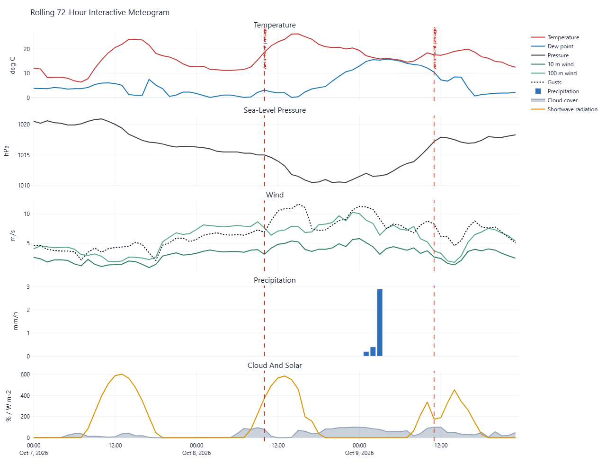

Example: 7–9 October 2026. [Original HTML](../reports/periods/2026-10-07_2026-10-09/assets/meteogram.html). Data: Open-Meteo; Atlas frontal annotations.

### P02. Yesterday hour by hour / daily meteogram — `daily_meteogram.html`

**Where:** daily overview and Weather page. This is the same five-panel construction as P01, restricted to the final local day. It contains temperature, dew point, pressure, 10/100 m wind, gust, precipitation, cloud and shortwave radiation, with the same units.

The daily figure is built without the period meteogram's frontal-event argument. Do not expect identical red annotations even when the daily chronology lists a front. It is a gridded day-long timeline, whereas the “Airport mean/rain/gust” headline cells use station observations.

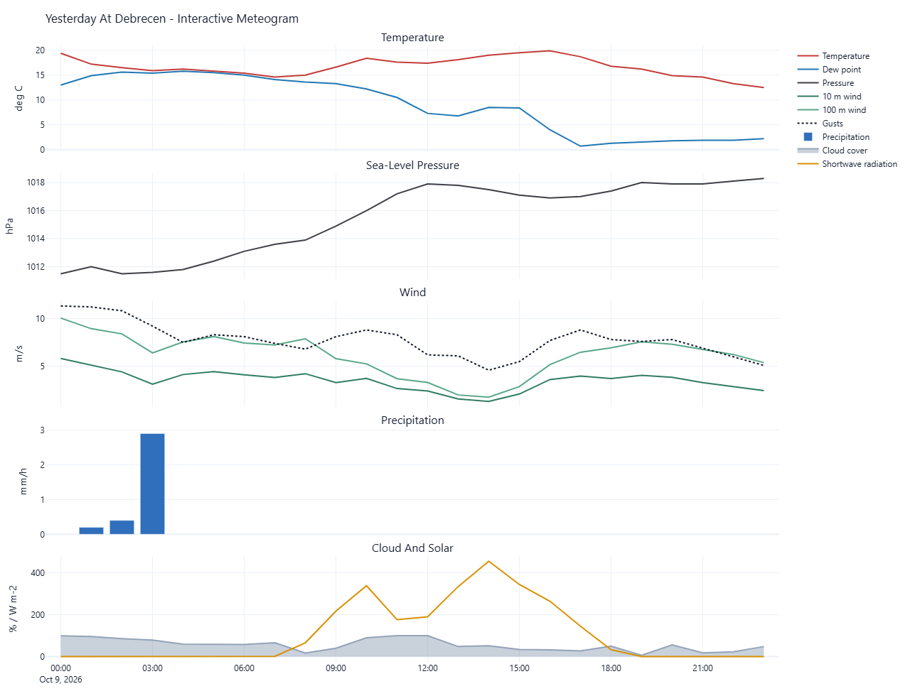

Example: 9 October 2026. [Original HTML](../reports/periods/2026-10-07_2026-10-09/assets/daily_meteogram.html). Data: Open-Meteo.

### P03. Debrecen Airport observation ledger — `station_comparison.html`

**Where:** Surface & Synoptic. Four time-aligned panels compare hourly station temperature with gridded temperature; station pressure with gridded pressure; observed wind and gust; and observed versus gridded precipitation. Temperature is °C, pressure hPa, wind m/s and precipitation mm per hourly interval.

Solid station and dotted gridded traces make disagreements visible rather than blending them away. The wind panel contains station wind/gust traces; it is not a complete pairwise comparison for every wind variable. Different sampling, grid representativeness and model error can all explain differences.

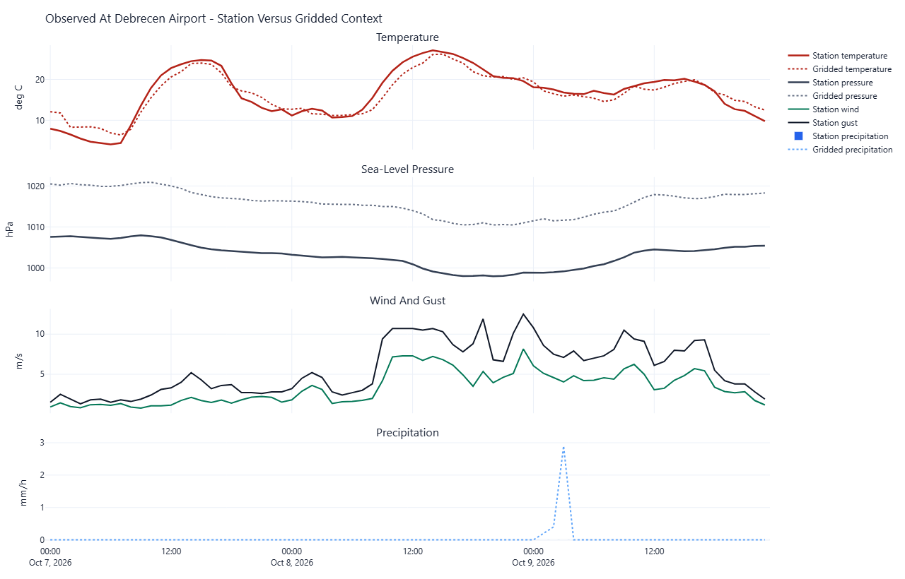

Example: 7–9 October 2026. [Original HTML](../reports/periods/2026-10-07_2026-10-09/assets/station_comparison.html). Sources: HungaroMet and Open-Meteo; hourly aggregation by Atlas.

### P04. Radar replay and accumulation — `radar_archive.html`

**Where:** Storms & Satellite. The left panel animates sampled reflectivity in dBZ on longitude/latitude axes. The right panel holds the full available-window radar accumulation proxy in mm. Debrecen is marked in both panels.

Play/pause and the time slider operate the reflectivity replay; the accumulation panel is not an hourly rain-rate frame. The reflectivity colour range is 0–65 dBZ. A high domain maximum may be far from the city. Display sampling, missing source frames and the fixed Z–R conversion limit interpretation; the map is not equivalent to rain-gauge totals.

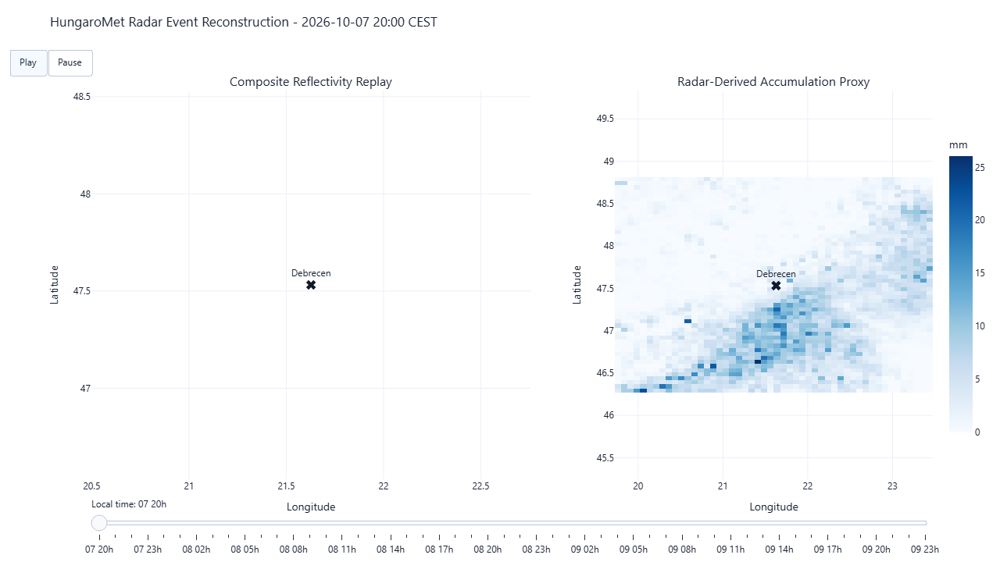

Example: saved initial state, 7–9 October 2026 edition. [Original HTML](../reports/periods/2026-10-07_2026-10-09/assets/radar_archive.html). Source: HungaroMet; accumulation and sampling by Atlas.

### P05. LINET lightning diary — `lightning_diary.html`

**Where:** Storms & Satellite. A longitude/latitude scatter map locates in-range LINET events; colour represents signed peak current in kA, and marker size increases with absolute current. Hover gives time, position, current and distance from Debrecen. The adjacent histogram shows events per hour in local time.

The map is thinned to at most 6,000 plotted events for performance; the hourly count series is separate. Neither point density nor current sign is a calibrated measure of local damage. An empty figure distinguishes unavailable input from a successfully read zero-event archive through its message and notes.

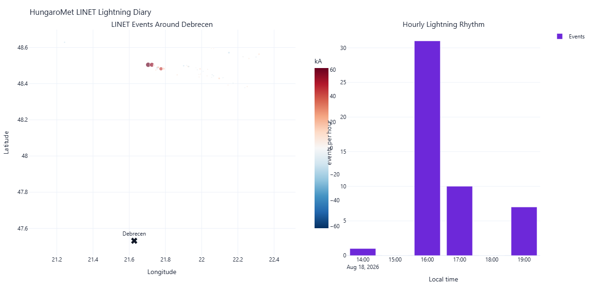

Example: **16–18 August 2026**, selected for actual recorded events. [Original HTML](../reports/periods/2026-08-16_2026-08-18/assets/lightning_diary.html). Source: HungaroMet LINET.

### P06. Meteosat, radar and lightning diary — `satellite_diary.html`

**Where:** Storms & Satellite. A product selector switches among the five MSG image types. Frame selection, play/pause and image zoom allow time-based inspection. Alongside the image, radar-maximum and lightning-count series provide event chronology; the selected image time is matched to nearby observations.

Read the timestamp and selected product before comparing cloud patterns. The neighbouring radar and lightning readings are time-linked, not pixels overlaid on the image. Daylight affects natural-colour interpretation; RGB colour does not directly equal precipitation, temperature or cloud height.

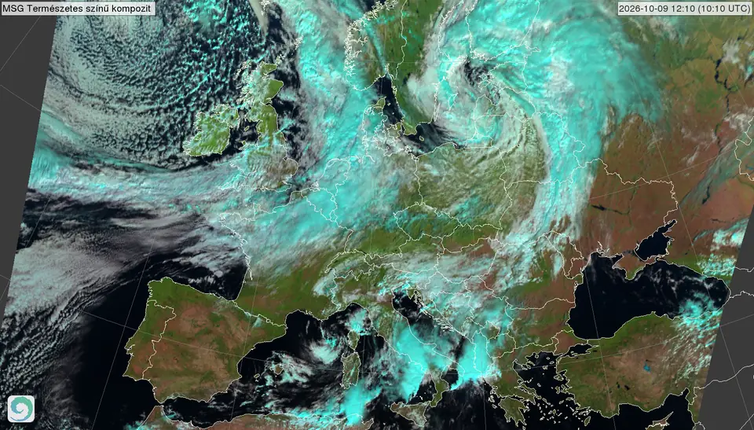

Example: **NaturalRGB, 9 October 2026, 10:10 UTC**, from the 7–9 October edition. This is the actual saved image frame, not the whole interactive UI. [Original diary HTML](../reports/periods/2026-10-07_2026-10-09/assets/satellite_diary.html). Source: HungaroMet MSG; this WebP was sampled/compressed by Atlas.

### P07. Selectable synoptic dynamics — `synoptic_evolution.html`

**Where:** Surface & Synoptic. Six-hourly regional maps offer five modes:

| Mode | Shading/contours shown | Units |
| --- | --- | --- |
| Air mass / surface | 850 hPa temperature; MSLP contours; 500 hPa height contours; 850 hPa wind arrows | °C, hPa, m, wind vectors |
| 300 hPa jet | 300 hPa wind-speed shading and height contours | m/s, m |
| 500 hPa vorticity | Derived relative-vorticity shading and 500 hPa heights | 10⁻⁵ s⁻¹, m |
| 700 hPa moisture / ascent | Relative humidity and vertical velocity | %, cm/s |
| 850 hPa theta-e / fronts | Approximate equivalent potential temperature; thermal-advection contours; positive frontogenesis contours | K, K/3 h, K/(100 km · 3 h) |

Select a layer and use the common animation timeline. These are coarse-grid screening diagnostics, not manually drawn fronts or a convection-resolving storm analysis. No 2-PVU dynamical-tropopause surface is supplied or approximated.

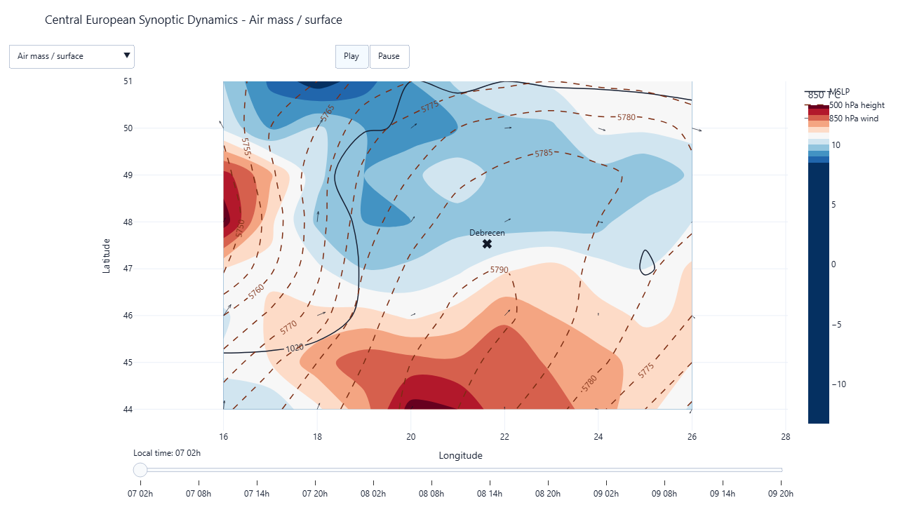

Example: saved initial mode/frame, 7–9 October 2026. [Original HTML](../reports/periods/2026-10-07_2026-10-09/assets/synoptic_evolution.html). Data: Open-Meteo historical model fields; Atlas-derived dynamics.

### P08. Physical PV and wind weather yield — `physical_energy.html`

**Where:** Land Surface & Energy. Three rows show reference PV power (kW/kWp) with cell temperature (°C); generic-turbine capacity factor (%) with atmospheric wind power density (W/m²); and cumulative PV energy (kWh/kWp) with wind full-load hours.

The dual axes distinguish different physical quantities. A rising cumulative curve means energy is accumulating, not that instantaneous power is increasing. The wind series uses 100 m wind and a generic turbine; PV uses a fixed reference array. Neither curve is measured production from a real facility.

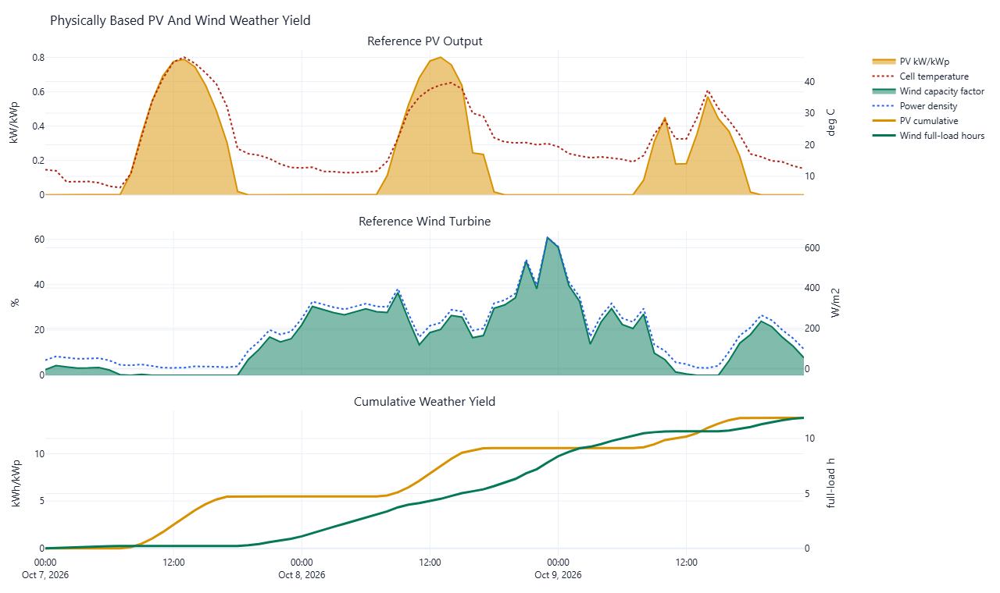

Example: 7–9 October 2026. [Original HTML](../reports/periods/2026-10-07_2026-10-09/assets/physical_energy.html). Data: Open-Meteo; reference-system modelling by Atlas/pvlib.

### P09. Daily PV and wind yield — `daily_physical_energy.html`

**Where:** daily Energy page. This is P08 restricted to the final local day, with independently calculated daily totals. It shows daily PV power/cell temperature, wind capacity/power density and accumulated daily yields.

Use it to see whether the day's reference output was concentrated in a few hours or sustained. A daily wind full-load-hour value is an equivalent energy duration, not a count of hours in which the turbine actually operated at rated output. A PV yield in kWh/kWp is normalized by installed peak capacity.

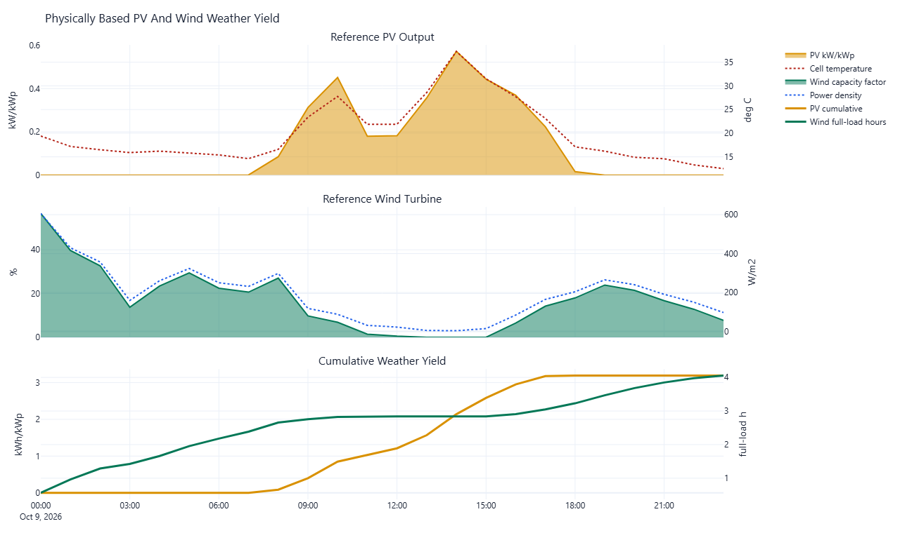

Example: 9 October 2026. [Original HTML](../reports/periods/2026-10-07_2026-10-09/assets/daily_physical_energy.html). Data: Open-Meteo; Atlas/pvlib calculations.

### P10. Seven-day weather diary — `seven_day_context.html`

**Where:** daily Climate Context and expert Climate & Analogs. Daily minimum/maximum **hourly sampled** temperature bounds form the top panel; daily rain totals form the middle panel; shortwave energy totals and mean 100 m wind share the bottom panel on separate axes.

Units are °C, mm, Wh/m² and m/s. The shaded final portion marks the active expert period, not a confidence interval. Earlier days show the transition into that period. Hourly-sampled temperature extrema are not guaranteed to equal the station's true instantaneous daily extrema.

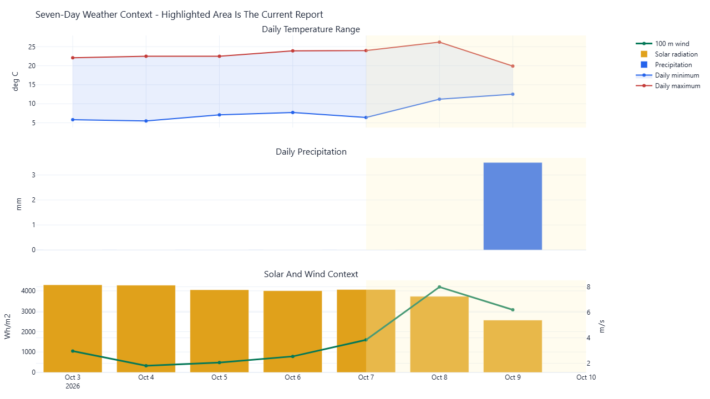

Example: context ending 9 October 2026. [Original HTML](../reports/periods/2026-10-07_2026-10-09/assets/seven_day_context.html). Data: Open-Meteo.

### P11. Wind regime / wind rose — `wind_rose.html`

**Where:** Surface & Synoptic. Stacked directional bars show how frequently **10 m** wind came from each compass sector. Colours separate 0–2, 2–4, 4–6, 6–8 and 8+ m/s speed bands; radial distance is frequency in percent.

A north-pointing spoke means wind arriving **from** the north, not moving toward the north. The rose summarizes frequency, not a time sequence, storm-motion map or power-density weighting. It uses a different height from the preferred 100 m wind used in several period metrics and renewable calculations.

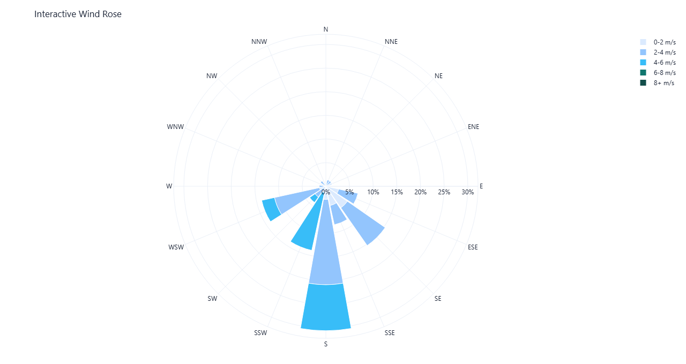

Example: 7–9 October 2026. [Original HTML](../reports/periods/2026-10-07_2026-10-09/assets/wind_rose.html). Data: Open-Meteo.

### P12. Pressure and frontal tendency — `pressure_tendency.html`

**Where:** Surface & Synoptic. The upper panel shows MSLP in hPa; the lower shows `pressure(t) − pressure(t−6 hours)` in hPa per six hours. Rising and falling tendencies have different colours; points with absolute change at least 4 hPa are emphasized.

This is a six-hour pressure diagnostic, not the separate three-hour compound front detector. A sharp pressure change can support passage interpretation, but pressure alone does not establish a front. The first six samples naturally lack a six-hour difference.

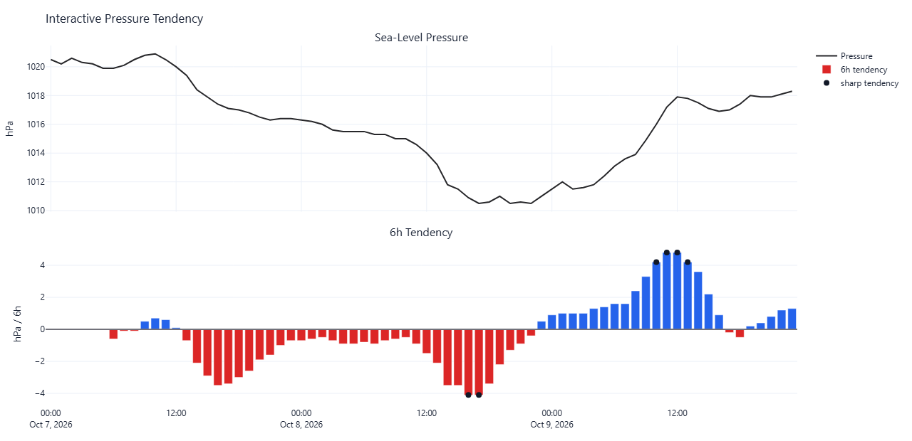

Example: 7–9 October 2026. [Original HTML](../reports/periods/2026-10-07_2026-10-09/assets/pressure_tendency.html). Data: Open-Meteo.

### P13. Temperature–dew-point spread — `dewpoint_spread.html`

**Where:** generated figure asset; not currently embedded as its own section in the main public/expert page composition. Temperature and dew point share a °C axis; their difference uses a second °C axis. Shading identifies sampled periods with temperature minus dew point **≤2°C**.

A small spread signals near-saturation, but it does not prove fog. The actual fog detector additionally requires visibility evidence and uses different humidity/spread criteria. This distinction prevents confusing a visual moisture indicator with an observed visibility event.

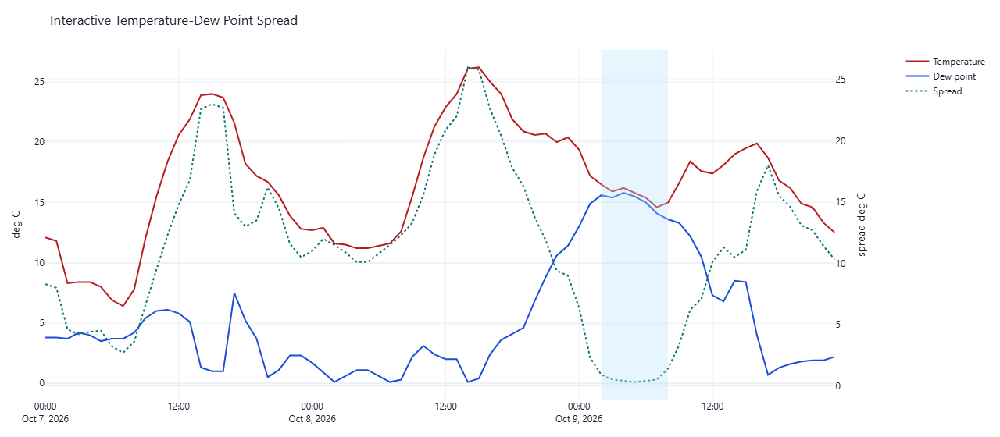

Example: 7–9 October 2026. [Original HTML](../reports/periods/2026-10-07_2026-10-09/assets/dewpoint_spread.html). Data: Open-Meteo.

### P14. Solar diurnal curves — `solar_diurnal.html`

**Where:** Climate & Analogs, under Solar Climatology. Each report day has a shortwave-irradiance curve against local hour (W/m²). The dashed reference is a pvlib clear-sky shape for a representative report date, scaled so its daily energy matches the median 1991–2020 same-window energy divided by report-day count.

It is **not an observed historical hourly median curve**, despite simplified wording elsewhere in the interface. It is an energy-scaled reference shape. Differences can reveal cloud suppression and intermittent sunshine, but they are not irradiance forecast errors or a statistical confidence band.

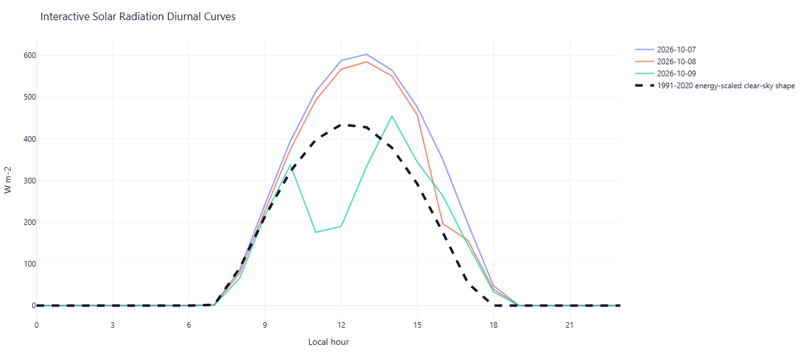

Example: 7–9 October 2026. [Original HTML](../reports/periods/2026-10-07_2026-10-09/assets/solar_diurnal.html). Data: Open-Meteo/ERA5; reference shape calculated using pvlib.

### P15. Anomaly structure — `anomaly_bars.html`

**Where:** Climate & Analogs. Six bars show standardized anomalies for temperature, precipitation, wind, pressure, cloud and shortwave energy. The live pipeline passes the **1991–2020 standard-normal** anomalies to this figure.

Bar height is standard deviations, not the original physical unit. Hover gives current value, reference mean, raw anomaly and empirical percentile. Positive means above the reference, not automatically “better”; a positive rainfall anomaly and positive wind anomaly have very different meanings. This plot does not display the recent-decade bars alongside the standard reference; P16 does.

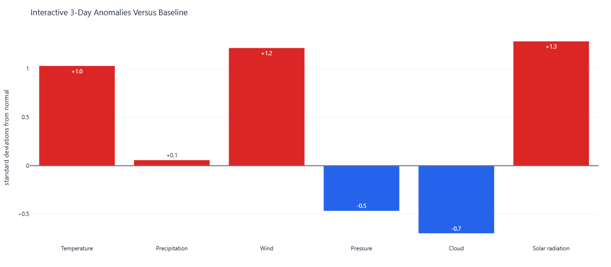

Example: 7–9 October 2026. [Original HTML](../reports/periods/2026-10-07_2026-10-09/assets/anomaly_bars.html). Data: Open-Meteo and ERA5; Atlas calculations.

### P16. Standard normal, recent decade and full record — `climate_reference.html`

**Where:** Climate & Analogs. The top panel compares grouped standardized anomalies against **1991–2020** and the **previous ten years** for the same six metrics. The bottom panel ranks the current window against same-calendar periods from the configured full ERA5 record.

The zero line marks each anomaly reference mean; the 50th-percentile line marks the empirical middle rank. Standard deviations differ between references, so two z-scores can differ even when raw anomalies are similar. The full-record percentile is not the probability of the next period or a return-period estimate.

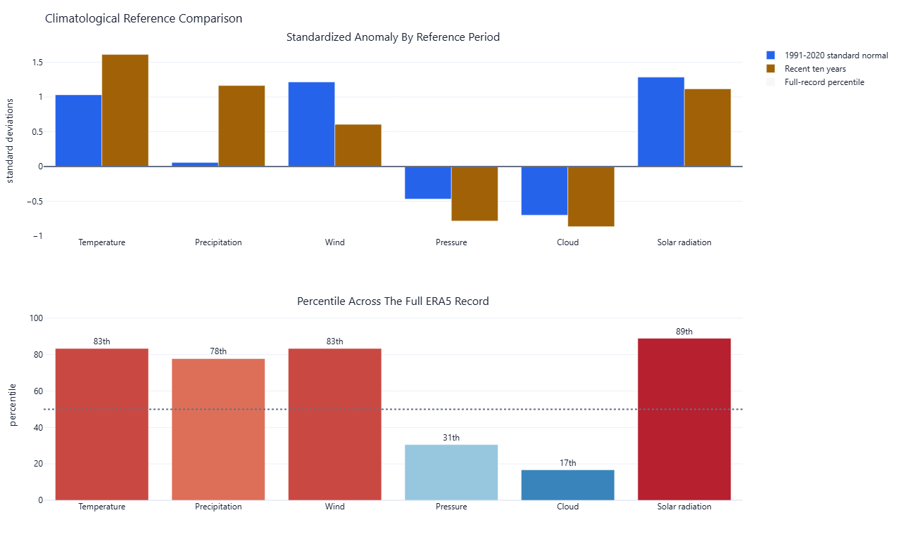

Example: 7–9 October 2026. [Original HTML](../reports/periods/2026-10-07_2026-10-09/assets/climate_reference.html). Data: Open-Meteo/ERA5.

### P17. How unusual was yesterday? — `daily_climate_reference.html`

**Where:** daily Climate Context. This repeats P16's design for the final **single day**, using same-calendar **one-day** climate samples. It is not the period anomaly relabelled as daily.

Temperature, precipitation, wind, pressure, cloud and shortwave totals are compared with their daily references. A dramatic daily percentile can coexist with a moderate three-day percentile because the accumulation/averaging window is different. Always compare like durations.

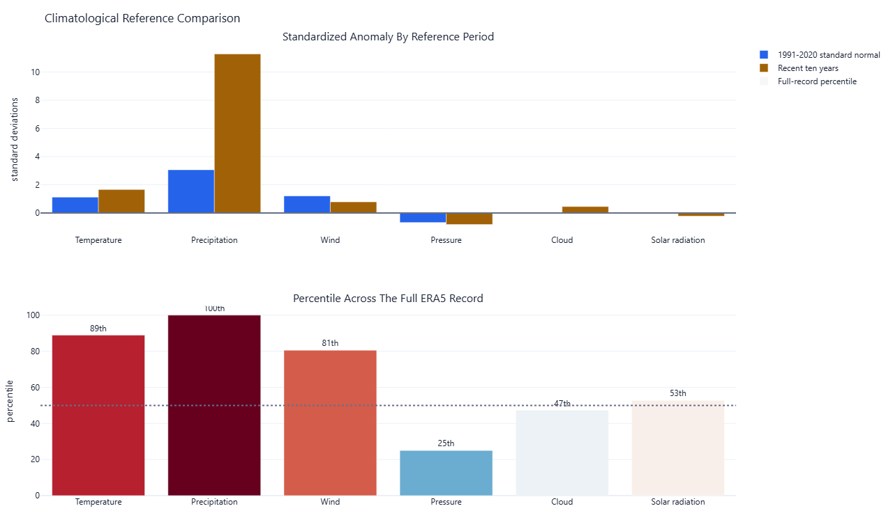

Example: 9 October 2026. [Original HTML](../reports/periods/2026-10-07_2026-10-09/assets/daily_climate_reference.html). Data: Open-Meteo/ERA5.

### P18. Land surface and water balance — `land_surface.html`

**Where:** Land Surface & Energy. Four rows show soil temperature at four depths (°C), volumetric soil moisture at those depths (m³/m³), hourly VPD with daily ET0 (kPa and mm/day), and daily/cumulative precipitation minus ET0 (mm/day and mm).

The view normally spans 90 days. Cumulative balance begins at the beginning of that displayed series; it is not an absolute measure of stored soil water. Soil layers react on different time scales. Negative P−ET0 means atmospheric demand exceeded precipitation in this simplified accounting, not that the soil is empty or irrigation is prescribed.

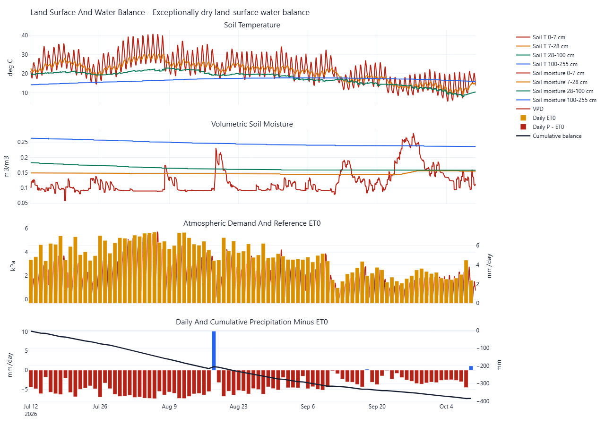

Example: context ending 9 October 2026. [Original HTML](../reports/periods/2026-10-07_2026-10-09/assets/land_surface.html). Data: Open-Meteo best-match land fields; ERA5 reference context.

### P19. Objective phenomena strip — `phenomena_timeline.html`

**Where:** Storms & Satellite. Horizontal line segments connect each event's start and end on a local-time axis; rows name event types. Hover exposes evidence, heuristic confidence and source provenance.

The strip contains threshold candidates, not a manually verified storm catalogue. Duration follows consecutive qualifying hourly evidence, with an exclusive end after the final qualifying hour. A blank strip must be read with source availability and quality notes: missing visibility or lightning evidence can prevent a detection.

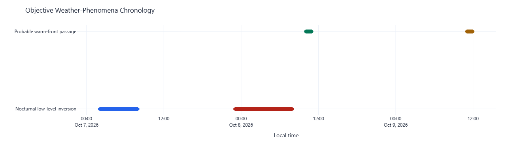

Example: 7–9 October 2026. [Original HTML](../reports/periods/2026-10-07_2026-10-09/assets/phenomena_timeline.html). Sources: station, radar, lightning and model fields as identified per event.

### P20. Daily regime evolution — `regime_strip.html`

**Where:** Climate & Analogs. One coloured segment per local day shows the simple daily class: frontal, sunny, stagnant, hot, frost or mixed. The vertical bar height is deliberately constant and carries no physical magnitude.

These daily rules differ from the period-scale anomaly-based regime. A period labelled “Mixed transition” can include a sunny day or a frontal day. Colours identify categories; they are not calibrated hazard levels, confidence scores or forecast probabilities.


Example: 7–9 October 2026. [Original HTML](../reports/periods/2026-10-07_2026-10-09/assets/regime_strip.html). Classification: Atlas, using Open-Meteo fields.

### P21. Hungary electricity context — `electricity_overview.html`

**Where:** Land Surface & Energy. Three panels show load/residual load (MW); available solar/onshore/offshore wind generation (MW); and day-ahead price (EUR/MWh). Negative price bars are coloured distinctly.

These are national system series. The renewable panel is not a complete generation-mix chart: other production types can exist in the download without being drawn here. Power is not energy; the MWh summary integrates intervals separately. Missing prices or production series leave an incomplete context rather than supporting a zero-value conclusion.

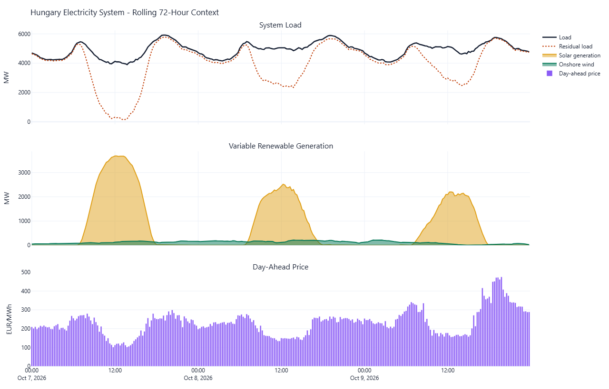

Example: 7–9 October 2026. [Original HTML](../reports/periods/2026-10-07_2026-10-09/assets/electricity_overview.html). Source: Energy-Charts/Fraunhofer ISE.

### P22. Weather–electricity relationships — `weather_electricity_links.html`

**Where:** Land Surface & Energy. Hourly-aligned points compare Debrecen shortwave irradiance (W/m²) with Hungary solar generation (MW), and Debrecen wind speed—preferably 100 m—with Hungary combined wind generation (MW). Where supported, a fitted linear trend summarizes the paired sample; this chart does not display a correlation coefficient.

Shared daylight or weather systems can produce association without proving local causation. Debrecen is one point; national generation depends on plant locations, installed capacity, availability and system operation. The fit is descriptive, not a production model, out-of-sample validation or trading signal.

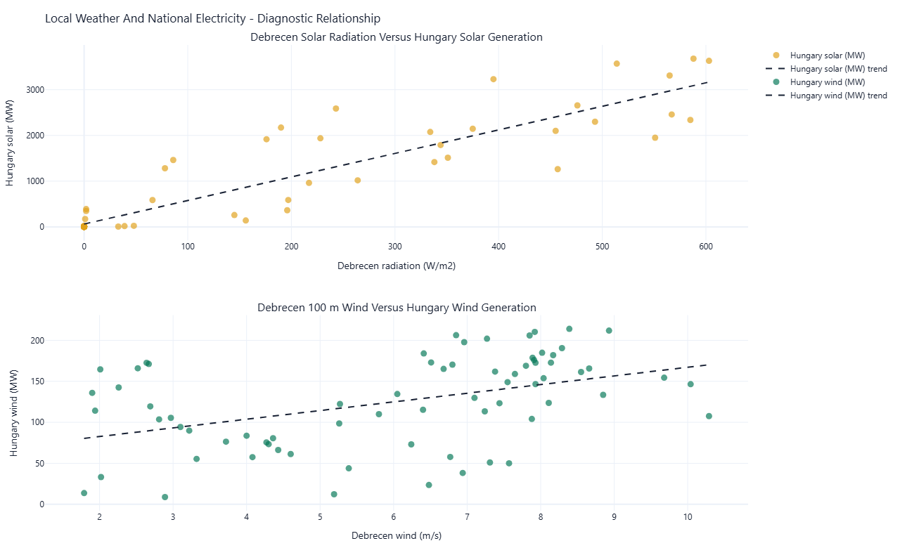

Example: 7–9 October 2026. [Original HTML](../reports/periods/2026-10-07_2026-10-09/assets/weather_electricity_links.html). Sources: Open-Meteo and Energy-Charts.

### P23. Model Skew-T — `model_profile.html`

**Where:** Upper Air & Dynamics. Temperature and dew point are shown against decreasing logarithmic pressure on a skewed temperature coordinate. Background isotherms and dry adiabatic guides aid interpretation. A neighbouring wind-speed profile colours markers by direction and exposes pressure, height and wind on hover.

The selected-profile annotation includes K index, Total Totals, surface-based CAPE/CIN, LCL height and precipitable water where calculable. Parcel quantities are calculated but a separate parcel-ascent curve is not drawn by this plotting function. Coarse model pressure levels are not a radiosonde and can miss shallow layers.

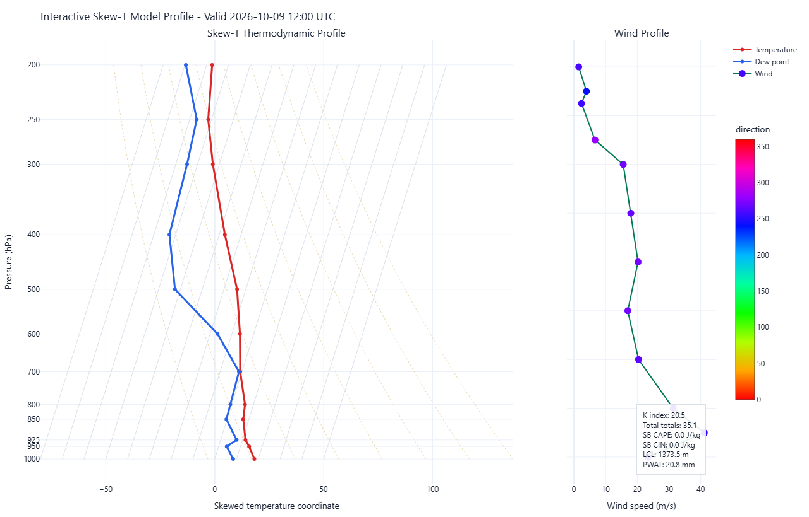

Example: profile selected for 9 October 2026, nearest 12 UTC. [Original HTML](../reports/periods/2026-10-07_2026-10-09/assets/model_profile.html). Data: Open-Meteo; diagnostics calculated with MetPy.

### P24. Parcel and boundary-layer evolution — `column_diagnostics.html`

**Where:** Upper Air & Dynamics. Four panels show the provider's hourly CAPE/CIN (J/kg), boundary-layer height (m AGL), integrated water vapour (kg/m²), and freezing level/2 m wet bulb (m ASL and °C).

These are **provider model series**, distinct from Atlas's independently calculated selected-profile parcel diagnostics. Different values are not necessarily a contradiction: parcel definitions, vertical resolution and time selection can differ. A high freezing level is not by itself a hail-size forecast; high CAPE is not proof that a storm formed.

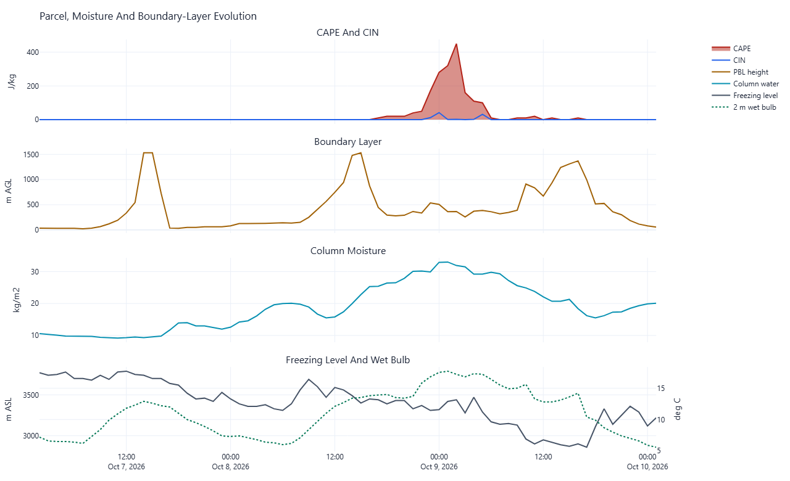

Example: 7–9 October 2026. [Original HTML](../reports/periods/2026-10-07_2026-10-09/assets/column_diagnostics.html). Data: Open-Meteo historical model fields.

### P25. Wind hodograph — `hodograph.html`

**Where:** Upper Air & Dynamics. The curve joins horizontal wind components with height: eastward `u` on the horizontal axis and northward `v` vertically, both m/s. Marker colour indicates height relative to the lowest available profile level, labelled km AGL; selected pressure levels are labelled and hover gives speed/direction.

The inset reports 0–1, 0–3 and 0–6 km bulk shear. Curve length and curvature describe speed/directional change with height, not a storm's observed path. The adjacent storm-relative tables use the same selected model profile and provide additional motion/helicity calculations.

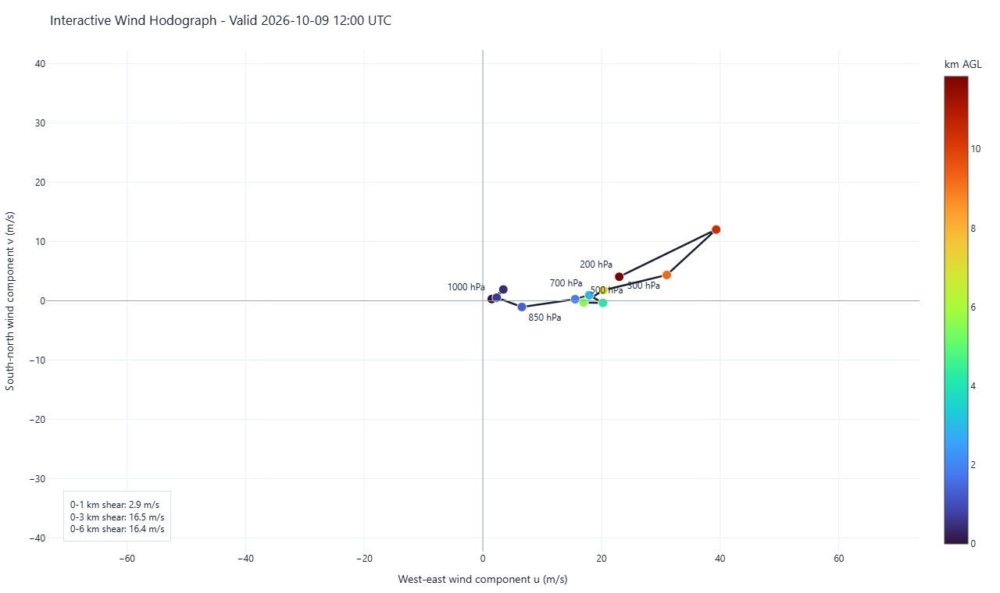

Example: selected 9 October 2026 profile. [Original HTML](../reports/periods/2026-10-07_2026-10-09/assets/hodograph.html). Data: Open-Meteo; Atlas diagnostics.

### P26. Air-mass back-trajectory — `air_mass_trajectory.html`

**Where:** Surface & Synoptic. A geographic path traces air backward from Debrecen through the 850 hPa wind field. Marker colour indicates hours before arrival. Hover gives position, distance from the city and model temperature; the city is marked separately.

The default request is 72 hours, integrated with 15-minute midpoint steps and stored hourly points. The endpoint is the last available trajectory-field time. Tracing stops at domain/data limits rather than extrapolating indefinitely. It is a single-pressure-level horizontal transport estimate, not a three-dimensional parcel path or a pollutant-source attribution.

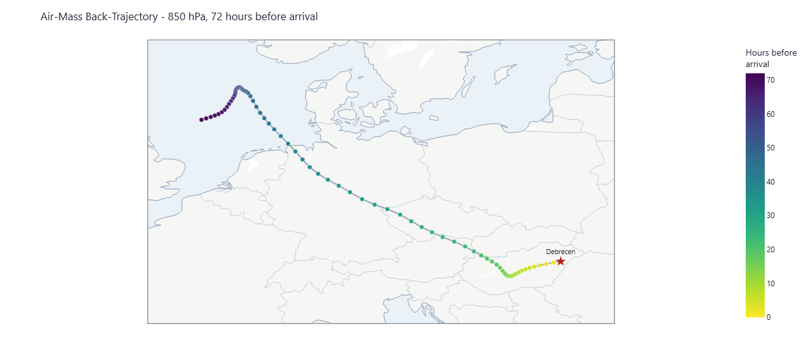

Example: saved trajectory in the 7–9 October 2026 edition. [Original HTML](../reports/periods/2026-10-07_2026-10-09/assets/air_mass_trajectory.html). Data: Open-Meteo; integration by Atlas.

### P27. Time-pressure atmospheric curtain — `time_pressure.html`

**Where:** Upper Air & Dynamics. Time runs horizontally and logarithmic pressure decreases upward. The selector switches the main heat map among relative humidity (%), temperature anomaly (°C) and wind speed (m/s). Hover also exposes absolute temperature, humidity, wind direction and geopotential height. Below it are surface pressure and precipitation.

Here “temperature anomaly” means departure from the **report-window mean at that same pressure level**. It is not a 1991–2020 climate anomaly. The curtain reveals moist layers, vertical evolution and timing, but interpolated colours do not add vertical observations between the supplied pressure levels.

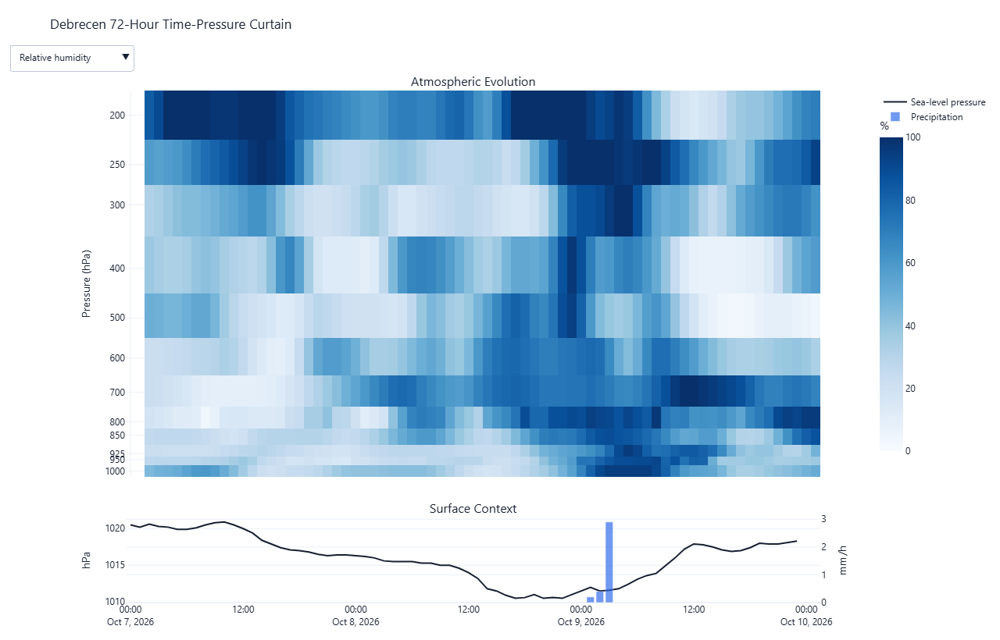

Example: saved initial mode, 7–9 October 2026. [Original HTML](../reports/periods/2026-10-07_2026-10-09/assets/time_pressure.html). Data: Open-Meteo historical model fields.

## 7. Surface-weather and climate metrics

### 7.1 Complete shared period-metric dictionary

The same calculation is used for the selected daily slice and complete expert period. These are gridded metrics, separate from station headline values.

| Metric key | Calculation and meaning | Unit |
| --- | --- | --- |
| `temperature_mean_c` | Mean valid hourly 2 m temperature | °C |
| `dew_point_mean_c` | Mean valid hourly 2 m dew point | °C |
| `precipitation_total_mm` | Sum of hourly precipitation | mm |
| `wind_speed_mean_ms` | Mean 100 m wind when usable; otherwise 10 m wind | m/s |
| `wind_gust_max_ms` | Maximum hourly 10 m gust value | m/s |
| `pressure_mean_hpa` | Mean hourly sea-level pressure | hPa |
| `pressure_range_hpa` | Maximum minus minimum sea-level pressure | hPa |
| `cloud_cover_mean_pct` | Mean hourly total cloud cover | % |
| `shortwave_total_wh_m2` | Sum of hourly mean shortwave irradiance times the implicit one-hour interval | Wh/m² |
| `sunshine_total_s` | Sum of interval sunshine durations | Seconds; divide by 3,600 for hours |
| `frost_hours` | Number of hourly temperatures **≤0°C** | Hours represented by qualifying samples |
| `cooling_degree_days_c` | Sum of `max(T−18, 0)` over hourly temperatures, divided by 24 | °C·days |
| `heating_degree_days_c` | Sum of `max(18−T, 0)` over hourly temperatures, divided by 24 | °C·days |

The metric key suffix `_c` for degree days should not obscure that the interpretation is **temperature difference × time**. The 18°C base is a fixed communication/energy-demand reference, not a calibrated building model.

Additional display aggregates include hourly-sampled daily minimum/maximum temperature; airport mean temperature, summed precipitation and maximum gust; daily 100 m wind mean; and daily radiation totals. Station and gridded means need not match.

### 7.2 Anomalies and percentiles

Six metrics receive the shared anomaly structure: temperature mean, precipitation total, preferred-height wind mean, pressure mean, cloud mean and shortwave energy total.

Each anomaly records the metric/label, current value, reference mean, raw difference, z-score, percentile and unit:

```text
raw anomaly = current value − reference mean
z-score = raw anomaly / reference population standard deviation
empirical percentile = 100 × fraction of valid reference samples ≤ current value
```

The reference standard deviation uses `ddof=0`. If it is zero, the implementation returns a z-score of zero rather than dividing by zero. Tied values count as less-than-or-equal for percentile ranking: a high dry-day precipitation rank can therefore reflect many ties at zero, not exceptional rainfall.

Percentiles are empirical positions in the selected sample. They are not Gaussian-tail probabilities, formal significance tests or estimates of event return periods.

### 7.3 Three references that must stay separate

| Reference | Selection | Interpretation |
| --- | --- | --- |
| Standard normal | Same-calendar ERA5 windows, 1991–2020; at least 24 valid years required | What “normal” means for the standard anomaly |
| Recent decade | Same-calendar windows in the previous ten completed years; at least five required | How the period compares with more recent climate |
| Full record | Same-calendar windows, 1990 through the year before the report | Empirical rank across the configured available record |

The daily report uses one-day reference windows; the expert report uses three-day windows. Temperature/pressure/cloud/wind are averaged over each climate window; precipitation, radiation and ET0 are accumulated. Leap-day mapping uses an available calendar date, with a February 28 fallback where necessary.

These are **gridded ERA5 reference statistics**, not a declaration that Atlas has reproduced an official station normal or homogenized station-record series.

## 8. Weather events and frontal passages

### 8.1 Every phenomenon detector

Station-hourly evidence is preferred for ordinary surface phenomena; gridded fallback provenance is explicit when used. Model snowfall and inversion detections remain model-derived even when the station is otherwise available.

| Event | Trigger | Main limitation |
| --- | --- | --- |
| Fog | Visibility ≤1,000 m **and** RH ≥95% or temperature–dew-point spread ≤1.2°C | Near-saturation alone is insufficient; visibility is needed |
| Low visibility | Visibility >1,000 and ≤5,000 m with the same humidity condition | A diagnostic category, not a coded aviation observation |
| Frost | Hourly temperature ≤0°C | Air-temperature threshold, not measured ground/plant frost |
| Heat stress | Hourly temperature ≥30°C | Not UTCI, WBGT or a physiological heat-dose calculation |
| Heavy rain | Hourly precipitation ≥5 mm **or** rolling three-hour precipitation ≥10 mm | Hourly sampling and missing intervals affect timing/totals |
| Strong gusts | Hourly maximum gust ≥15 m/s | Not an official warning level |
| Snow | Positive model snowfall and qualifying-episode mean 2 m temperature ≤1°C | Model-indicated, not direct confirmation of snow at the airport |
| Mixed precipitation | Positive model snowfall with episode mean temperature >1°C | A coarse thermal heuristic, not a precipitation-type retrieval |
| Thunderstorm | At least one hourly LINET event; radar maximum supplies supporting evidence when available | Applies within the configured regional radius, not necessarily over the city |
| Nocturnal low-level inversion | Model 925 hPa temperature at least 1°C warmer than 1000 hPa, during local 18:00–08:00 | A pressure-level proxy that can miss shallow inversions |
| Probable front/trough | Compound surface-change rules below | A local signature, not a manually located frontal boundary |

The fog/low-visibility expression means `visibility condition AND (RH condition OR spread condition)`.

Qualifying hourly samples are grouped into episodes, splitting when successive selected times are more than 90 minutes apart. Episode end is the final selected hour plus one hour. Each ledger entry includes start/end, kind, evidence text, confidence and source.

### 8.2 Event confidence

Confidence is a declared heuristic evidence weight, **not a calibrated probability**. Ordinary station-based surface events use 0.92; gridded fallback uses 0.68. Low visibility is reduced by 0.05, with a 0.5 floor. Snow/mixed precipitation uses 0.62; nocturnal inversion uses 0.66.

Lightning-based thunderstorm episodes use 0.86 without finite radar support, 0.90 with finite radar support below 35 dBZ, and 0.96 when the supporting maximum reaches 35 dBZ. A 0.96 label does not mean there is a validated 96% chance of a storm over Debrecen.

### 8.3 Complete frontal-candidate rules

The detector evaluates hourly data and three-hour changes. Each of these contributes one signal:

| Signal | Threshold |
| --- | --- |
| Pressure change | Absolute three-hour change ≥2.5 hPa |
| Temperature change | Absolute three-hour change ≥2°C |
| Wind-direction change | Wrapped absolute three-hour change ≥45° |
| Precipitation | Rolling three-hour total ≥0.5 mm |
| Gust | Gust ≥8 m/s |
| Wind-speed change | Absolute three-hour change ≥2 m/s |

At least **three** signals are required, plus an anchor: qualifying pressure change, qualifying precipitation, or gust **≥10 m/s**. This suppresses ordinary daily thermal/wind cycles but cannot eliminate all false signatures.

Nearby candidate hours are consolidated with a six-hour gap criterion; the highest-score hour is retained. A three-hour temperature fall ≤−2°C gives “Probable cold-front passage”; a rise ≥2°C gives “Probable warm-front passage”; otherwise the label is “Probable frontal trough or wind-shift line.”

The event retains pressure/temperature change, wind shift, three-hour precipitation, integer score and briefing. Confidence is `min(0.45 + 0.085 × score, 0.95)`. Dew-point change is also calculated in the diagnostic series but is **not** one of the six scored signals.

## 9. Atmospheric, storm and transport diagnostics

### 9.1 Selected-profile thermodynamic dictionary

| Metric | Meaning | Unit / reference |
| --- | --- | --- |
| `surface_based_cape_j_kg` | Buoyant energy from a parcel initialized at the lowest usable supplied model pressure level | J/kg; not necessarily a parcel observed at literal ground level |
| `surface_based_cin_j_kg` | Integrated inhibition for that parcel | J/kg; retain the supplied calculation's sign convention |
| `lcl_pressure_hpa`, `lcl_height_m_asl` | Lifted condensation level | hPa and m ASL |
| `lfc_pressure_hpa`, `lfc_height_m_asl` | Level of free convection when identifiable | hPa and m ASL |
| `equilibrium_level_pressure_hpa`, `equilibrium_level_height_m_asl` | Parcel/environment equilibrium level when calculable | hPa and m ASL |
| `precipitable_water_mm` | Water-vapour integral over the available model profile | mm; not predicted rainfall |
| `wet_bulb_zero_m_asl` | Interpolated height of the first suitable wet-bulb 0°C crossing | m ASL |
| `freezing_level_m_asl` | Interpolated dry-temperature 0°C crossing | m ASL |
| `k_index` | `(T850−T500) + Td850 − (T700−Td700)` | Conventional index calculated from °C values |
| `total_totals_index` | `T850 + Td850 − 2T500` | Conventional index |
| `lapse_rate_850_500_c_km` | Temperature drop between 850/500 hPa divided by their height difference | °C/km |

MetPy parcel calculations require at least five usable pressure/temperature/dew-point levels. Unsupported results remain unavailable. A missing LFC/EL can reflect either the thermodynamic profile or insufficient support; it should not be replaced by zero height.

Height labels matter: **ASL** means above sea level, while **AGL** means above ground. Hodograph/kinematic relative heights use the lowest valid model-level height as their zero; they do not introduce a new observed surface elevation.

### 9.2 Provider column diagnostics

The selected-time diagnostic dictionary also exposes `model_cape_j_kg`, `model_cin_j_kg`, `model_freezing_level_m_asl`, `boundary_layer_height_m`, `model_column_water_kg_m2`, `wet_bulb_temperature_2m_c` and `ventilation_index_m2_s`.

Ventilation index multiplies model boundary-layer height by mean supplied low-level wind, selecting levels within at least a 500 m layer or the boundary-layer depth when deeper. It is an atmospheric mixing/transport proxy, **not an air-quality measurement**. Column water in kg/m² is numerically equivalent to liquid-water mm, but the model series and profile-derived PWAT need not integrate precisely the same levels or assumptions.

### 9.3 Storm-relative parameters

The selected profile supports:

- 0–1, 0–3 and 0–6 km bulk shear, including magnitude and eastward/northward components, in m/s;
- Bunkers right-moving and left-moving storm-motion vectors and 0–6 km mean wind;
- motion speed and bearing **toward** which a hypothetical storm would travel;
- 0–1 and 0–3 km storm-relative helicity, with positive, negative and total components in m²/s².

Helicity is calculated relative to the **Bunkers right mover**. At least five valid wind levels are required for the kinematics calculation. Unsupported deeper layers are omitted rather than extrapolated.

These are environmental diagnostics. They do not say that a supercell occurred, that either Bunkers motion was realized, or that a tornado probability was computed. Wind “from” direction and storm-motion “toward” bearing are deliberately different conventions.

### 9.4 Synoptic derived quantities

Relative vorticity is the horizontal finite-difference curl `∂v/∂x − ∂u/∂y`, scaled to 10⁻⁵ s⁻¹. Thermal advection is `−(u∂T/∂x + v∂T/∂y)` scaled to a three-hour temperature tendency. Equivalent potential temperature is a moisture-adjusted potential-temperature approximation from 850 hPa temperature/humidity.

Frontogenesis uses horizontal temperature-gradient magnitude, deformation and divergence on the sampled grid, scaled to K/(100 km · 3 h). Spherical grid spacing is accounted for, but coarse finite differences and boundary effects still limit all these fields. Read them as contextual patterns, not exact local frontal intensities.

### 9.5 Air-mass-origin dictionary

The trajectory summary retains pressure level, requested/traced hours, hourly positions/times/temperatures, origin compass sector, straight-line origin distance, total path length, mean transport speed, arrival-minus-origin temperature change and a domain-exit flag.

Path length is the accumulated curved-path distance; origin distance is the direct distance from Debrecen to the farthest traced endpoint. Mean transport speed is path length divided by traced elapsed time. A source-region sector is a geometric description, not a formal air-mass classification such as maritime polar or continental tropical.

### 9.6 Radar-cell dictionary

Cells are contiguous supplied-grid pixels at **≥35 dBZ**, requiring at least **15 km²** area. Atlas uses reflectivity-weighted centroids and links adjacent-frame centroids by nearest plausible displacement, limiting association speed to **40 m/s**. This is simple object tracking; splits, mergers, missing frames and coarse replay sampling can alter track identity.

Each observation retains time, centroid coordinates, area, maximum/mean dBZ and centroid distance from Debrecen. Each track reports identifier, duration, mean movement speed, overall bearing, peak dBZ, peak area and closest centroid approach. The public table displays up to eight tracks; the lead identifies the strongest and nearest tracks.

Intensity-area classes are **Light 5–20**, **Moderate 20–35**, **Convective 35–50** and **Intense ≥50 dBZ**. Each class has peak and mean area across analysed frames. These are exclusive intensity bands, not cumulative “at least this intensity” areas. Areas and closest approach are inferred from the supplied sampled grid, not independently observed storm boundaries or hail footprints.

## 10. Land, water balance and renewable energy

### 10.1 Land metric dictionary

| Key | Meaning |
| --- | --- |
| `precipitation_90d_mm` | Total precipitation across the available trailing 90-day daily context |
| `et0_90d_mm` | Total FAO-56 reference ET0 over that context |
| `water_balance_7d_mm`, `water_balance_30d_mm`, `water_balance_90d_mm` | Trailing sums of precipitation minus ET0 |
| `vpd_max_kpa` | Maximum hourly VPD across the supplied land context |
| `soil_temperature_surface_c` | Final hourly 0–7 cm soil temperature |
| `soil_moisture_surface` | Final hourly 0–7 cm volumetric soil moisture |
| `soil_moisture_root_zone` | Final hourly 28–100 cm volumetric soil moisture |

The daily land table additionally has precipitation, ET0, P−ET0, mean/max VPD and daily mean selected soil fields. Snapshot soil metrics are final-hour values, not daily means; the daily table uses separate averaging.

Each 7/30/90-day balance is ranked against fixed-ERA5 **1991–2020 same-calendar** balance windows. The 90-day percentile supplies the context label: ≤10 exceptionally dry; >10–25 sustained deficit; ≥90 exceptionally wet; ≥75–<90 sustained surplus; otherwise near-normal seasonal balance. A contextual label is not proof of observed soil-water availability; inspect whether its reference percentile exists.

`P−ET0` excludes runoff, drainage, irrigation, snow storage, groundwater, rooting characteristics and crop-specific evapotranspiration. The calculation uses the available trailing rows and does not itself prove every requested land-context day was observed.

### 10.2 Renewable-weather communication indices

These 0–100 scores are distinct from physically modelled energy. The live pipeline compares with the standard-normal means.

```text
ratio_index(value, reference) = clamp(100 × value/reference, 0, 100)
cloud_penalty = clamp(0.35 × max(cloud% − normal_cloud%, 0), 0, 30)
solar_index = clamp(ratio_index(shortwave_total, normal_shortwave_total) − cloud_penalty)

calm_penalty = clamp(12 × max(3 − preferred_mean_wind, 0), 0, 36)
wind_index = clamp(ratio_index(preferred_mean_wind³, normal_mean_wind³) − calm_penalty)

combined_score = clamp((solar_index + wind_index) / 2)
```

Here `clamp` ordinarily limits to 0–100. Invalid/nonpositive-reference ratio inputs use a neutral 50 fallback; that is part of the index implementation, not evidence that data passed an observational quality test.

The wind index cubes the **period-mean speed**; it is not the mean of cubed hourly speeds. Both ratio scores saturate at 100, so above-normal energy does not produce an index greater than 100. This is not an arbitrary percentile or a turbine/PV efficiency.

The label is “solar-favored” when solar exceeds wind by at least 10 points, “wind-favored” for the reverse, and “balanced renewable” otherwise. Daily and period indices are calculated separately.

### 10.3 Physical PV model

The reference array is fixed, **35° tilted and south-facing (180° azimuth)**. Solar position comes from pvlib. Direct horizontal radiation is converted to DNI when the solar-zenith cosine exceeds 0.065, with DNI clipped to 0–1,200 W/m². Global/direct/diffuse radiation feeds plane-of-array transposition using albedo 0.2.

Faiman cell temperature uses plane-of-array irradiance, air temperature and 10 m wind. Normalized output is:

```text
PV kW/kWp = clip[(POA / 1000) × (1 − 0.004 × (cell_temperature − 25)) × 0.96, 0, 1.2]
```

Outputs include `pv_yield_kwh_per_kwp`, `pv_capacity_factor_pct`, peak-PV timestamp, hourly POA irradiance, cell temperature and normalized PV power. Hourly normalized powers are summed as one-hour energy intervals; their mean times 100 is the capacity factor.

This is a reference weather-yield calculation. It does not model a specific inverter, rooftop shading, orientation mismatch, soiling, snow-cover losses, outage or measured production. A yield of 3 kWh/kWp means 3 kWh per installed peak kW under the reference assumptions, not a 3 kW power reading.

### 10.4 Physical wind model

The wind model uses **100 m** wind, with moist-air density estimated from temperature, humidity and **sea-level pressure**. Using MSLP is an implementation approximation, not a direct hub-height pressure observation.

Density-corrected speed is `v × (rho/1.225)^(1/3)`, with the density ratio clipped to 0.5–1.5. The generic turbine is off below **3 m/s**, follows a normalized cubic curve between **3 and 12 m/s**, is rated from **12 to below 25 m/s**, and is off at **25 m/s or above**.

```text
partial-load capacity factor = (v_corrected³ − 3³) / (12³ − 3³)
atmospheric wind power density = 0.5 × air_density × uncorrected_100m_speed³
full-load hours = sum(hourly capacity factors)
capacity factor (%) = 100 × mean(hourly capacity factors)
```

The hourly series also exports air density, raw hub wind, density-corrected wind and power density. Summary outputs include full-load hours, capacity factor, mean power density and peak reference-wind timestamp where included in the evidence product.

Power density is atmospheric energy flux per swept area, not electrical production per land area. The model does not represent a named turbine, terrain-flow adjustment, wake loss, curtailment, availability or a farm layout.

## 11. All six activity lenses and every scoring rule

**Version note:** the archived examples and rule table in this section describe
methodology 1. Newly calculated editions use [methodology 2.0](activity_lenses_v2.md),
with expected-slot validity, hourly activity windows, severity ceilings, separate
commute journeys and independent seasonal-solar/PV evidence. See the
[calibration review](activity_lenses_calibration.md). Historical ratings have not
been recalculated; the JSON envelope version and scoring methodology version are
separate identifiers.

### 11.1 What is rated

The daily overview publishes cycling, walking, outdoor commute, hands-on gardening, solar-energy and outdoor-temperature-comfort ratings. They describe a **completed day's conditions**, not tomorrow's suitability or personal safety.

Despite the general “observational lens” description, the current daily calculation reads the saved daily **gridded hourly weather** plus the calculated solar index/reference-PV evidence. It is not calculated solely from the airport ledger.

Each lens starts at **100**. For each applicable rule, only the first matching severity band is deducted. Deductions across different rules add, then the score is floored at zero. Scores **80–100** are favorable, **55–79** mixed and **0–54** difficult.

If any required fact has less than **90%** hourly coverage, only that lens becomes `insufficient-evidence`. Expected counts respect the local day's 23/24/25 hours. The commute lens uses the eight local hours **06:00–<10:00 and 15:00–<19:00**. Missing normalized solar index is not reconstructed from raw radiation alone.

### 11.2 Evidence facts

The engine records precipitation total, wet hours (hourly precipitation **≥0.1 mm**), daily minimum/maximum temperature, cold hours (**<5°C**), hot/humid hours (**temperature ≥28°C and RH ≥60% simultaneously**), mean humidity, mean 10 m wind, maximum gust, mean cloud, shortwave total, sunshine hours and reference evapotranspiration total. Supplemental facts include the daily solar index and reference PV yield.

Facts retain units, coverage and source-column references. Not every recorded fact produces a deduction: sunshine, mean wind or PV yield can provide context without being scoring rules.

### 11.3 Shared precipitation deductions

These apply independently to cycling, walking, commute and gardening, using the lens's full-day or commute-window evidence:

| Rule | Band | Deduction |
| --- | --- | --- |
| Total precipitation | ≥10 mm | 35 |
| Total precipitation | ≥2 and <10 mm | 20 |
| Total precipitation | ≥0.2 and <2 mm | 8 |
| Wet duration | ≥6 wet hours | 20 |
| Wet duration | ≥2 and <6 wet hours | 10 |
| Wet duration | One wet hour | 5 |

Rain amount and duration are separate rules, so both can deduct points. Unlisted benign bands deduct zero.

### 11.4 Every lens-specific deduction

| Lens | Fact | Bands and deductions |
| --- | --- | --- |
| Cycling | Maximum gust | ≥18 m/s: −40; 12–<18: −24; 8–<12: −10 |
| Cycling | Maximum temperature | ≥35°C: −30; 30–<35: −15 |
| Cycling | Minimum temperature | <0°C: −25; 0–<5: −12 |
| Walking | Maximum gust | ≥20 m/s: −30; 14–<20: −15 |
| Walking | Maximum temperature | ≥35°C: −30; 31–<35: −15 |
| Walking | Minimum temperature | <−5°C: −25; −5–<2: −10 |
| Outdoor commute | Maximum gust in commute windows | ≥16 m/s: −30; 10–<16: −14 |
| Outdoor commute | Maximum temperature in commute windows | ≥32°C: −20 |
| Outdoor commute | Minimum temperature in commute windows | <0°C: −18 |
| Hands-on gardening | Maximum gust | ≥16 m/s: −30; 10–<16: −15 |
| Hands-on gardening | Maximum temperature | ≥33°C: −25; 29–<33: −12 |
| Hands-on gardening | Minimum temperature | <0°C: −25 |
| Solar-energy conditions | Solar index | <30: −55; 30–<60: −30; 60–<80: −12 |
| Outdoor temperature comfort | Maximum temperature | ≥35°C: −45; 30–<35: −25 |
| Outdoor temperature comfort | Hot/humid duration | ≥6 hours: −25; 2–<6 hours: −12 |
| Outdoor temperature comfort | Hours below 5°C | ≥8 hours: −30; 2–<8 hours: −15 |

The first four lenses also receive the shared rain/wet-duration deductions; solar and temperature comfort do not. A gardening score is not soil-workability or crop-water advice. The comfort lens is not UTCI/WBGT and does not model individual health, clothing or exertion.

The saved `atlas.activity-lenses/1` document includes status, rating, score, evidence facts, triggered rule explanations, severity/deduction and the complete possible rule schedule. Legacy editions without this evidence are not retroactively assigned invented ratings.

## 12. Electricity-system metrics

| Summary field | Meaning | Unit |
| --- | --- | --- |
| `average_load_mw`, `peak_load_mw` | Mean and maximum available national system load | MW |
| `solar_generation_mwh` | Interval-integrated available solar output | MWh |
| `wind_generation_mwh` | Integrated available onshore/offshore wind combined | MWh |
| `renewable_share_mean_pct` | Mean provider share-of-load series; fallback is mean available solar+wind divided by load | % |
| `residual_load_mean_mw` | Mean supplied residual-load series | MW |
| `average_price_eur_mwh`, `peak_price_eur_mwh` | Mean and maximum available day-ahead prices | EUR/MWh |
| `net_import_mean_mw` | Mean summed cross-border flow-derived series | MW; provider sign convention |
| `available` | Whether a usable electricity frame exists | Boolean, not a completeness percentage |
| `label` | Solar-led, wind-led, balanced solar/wind, partial context or unavailable | Text |

Power is integrated over inferred source intervals for MWh. The implementation uses a typical valid interval for the first sample and clips individual inferred intervals to 0–1.5 hours, avoiding unlimited integration across long gaps. Means of prices/shares are arithmetic means of available rows, not volume-weighted market prices or a guaranteed complete-period energy balance.

The fallback renewable share covers the available solar/wind columns, **not all renewable technologies**. It need not match the provider's broader renewable-share definition. Solar-led/wind-led labels use a 1.2 ratio between integrated solar and wind energy when both exist.

The relationship chart aligns hourly weather and electricity, plots paired values and fits a descriptive straight-line trend where at least three pairs and more than one distinct weather value are available. It does not display correlation or adjust for seasonality, diurnal confounding, capacity changes or geographic mismatch. The correlation in the separate station-verification table is a different calculation.

## 13. Historical summaries, records, regimes and analogs

### 13.1 Season & Month Summary

The summary page uses all daily values in the configured completed-year ERA5 archive, not just the 1991–2020 standard period and not just saved Atlas editions. A single selector switches among 12 calendar months and four meteorological seasons.

Each period retains number of represented years and displays six summary quantities: mean daily temperature, mean period-total precipitation, mean wind, mean cloud, mean period-total shortwave energy and mean period-total P−ET0. The almanac download preserves the same climatological field set and the associated record entries.

Winter is December–February, spring March–May, summer June–August and autumn September–November. December belongs to the following January/February's season year. These are climatological summaries over the archive, **not a report of the latest individual month**. Edge winters can be partial at the beginning/end of a finite archive; do not assume every represented winter has all three months.

Period record lists include warmest, coldest, wettest, windiest, sunniest and driest daily entries. Each records value, unit and date.

### 13.2 Record book

All-time cards cover warmest daily mean temperature, coldest daily mean temperature, wettest daily precipitation, windiest daily mean wind, highest daily solar energy, cloudiest/clearest daily mean cloud, most negative daily P−ET0, and highest/lowest daily mean pressure. The month table shows warmest, coldest, wettest and windiest daily entries for each month.

“All time” means **within Atlas's available daily ERA5 archive beginning in 1990**. “Warmest day” is the highest **daily mean**, not the highest instantaneous temperature. “Windiest” is daily mean preferred-height wind, not a gust record. “Sunniest” is highest shortwave energy, not longest sunshine duration. “Driest” is minimum daily P−ET0, not the longest rainless spell. These are not certified HungaroMet station records.

### 13.3 Period-scale regime rules

The classifier applies the following rules in order, using standard-normal z-scores. The first match wins.

| Regime | Required signals |
| --- | --- |
| Sunny high-pressure period | Radiation z ≥0.7; cloud z ≤−0.5; precipitation z ≤−0.4; pressure z ≥0 |
| Cloudy stagnant period | Wind z ≤−0.5; cloud z ≥0.6; radiation z ≤−0.6 |
| Wet frontal period | Precipitation z ≥0.8 and pressure range ≥10 hPa |
| Windy frontal period | Wind z ≥0.9 and pressure range ≥10 hPa |
| Heat-stress period | Temperature z ≥1 and cooling degree days ≥12 |
| Cold/frost-prone period | Temperature z ≤−1 and frost hours ≥6 |
| Mixed transition period | No earlier rule matches |

A briefing states raw temperature, precipitation, wind and radiation anomalies; an accompanying signal list explains the selected class. The daily headline can use the same period-classifier logic on a one-day slice with daily climate references. It is distinct from the simpler strip labels below.

### 13.4 Daily-strip regime rules

These also use first-match order:

1. **Frontal:** daily precipitation ≥8 mm and preferred-height mean wind ≥4 m/s.
2. **Sunny:** daily shortwave energy ≥2,500 Wh/m² and cloud ≤45%.
3. **Stagnant:** cloud ≥75% and mean wind <3 m/s.
4. **Hot:** daily mean temperature ≥27°C.
5. **Frost:** at least three hourly temperatures ≤0°C.
6. **Mixed:** otherwise.

These absolute rules are convenient summaries, not mutually exclusive physical regimes determined independently of ordering.

### 13.5 Historical analogs

The search uses the previous **15 completed years** of daily ERA5 and constructs rolling three-day periods. Candidate midpoints must lie within **±45 calendar-season days** of the report's seasonal position. The five nearest nonoverlapping winners are retained when sufficient data exist.

The feature vector is mean temperature, total precipitation, mean **10 m wind**, total shortwave energy, mean cloud and mean pressure, with respective weights **1.2, 1, 1, 1, 0.8, 0.8**. Features are centred on candidate medians and scaled by candidate sample standard deviations. Distance is the square root of the weighted mean squared standardized difference.

```text
similarity (%) = 100 × exp(−0.5 × distance²)
```

Each match retains start/end dates, distance, similarity, character label and feature metrics. Character words describe warm/cool, wet/dry, windy, bright or cloudy deviations relative to the candidate background. Similarity is an interpretable weather-state distance transform, not the chance that the same impacts occur or a measured forecast skill score.

## 14. Weather Story graph and supporting tables

### 14.1 Weather Story graph

The Weather Story graph is a separate published visual, outside the 27 generated figure files. Its nine nodes are:

| Node | Facts and interpretation |
| --- | --- |
| Atmospheric setup | Period regime, rule signals, mean pressure and period length |
| Surface weather | Mean cloud, cloud percentile and precipitation |
| Thermal character | Mean temperature, standard anomaly and full-record rank |
| Observed phenomena | Event-ledger count, regional lightning count and radar maximum, with source limitations |
| Passage diagnosis | Frontal candidate timing/evidence, or absence/unavailability explanation |
| PV energy impact | Reference yield, PV capacity factor and radiation anomaly |
| Land-surface impact | Seven-/30-day P−ET0 balance and maximum VPD |
| Boundary layer | Selected model PBL height, profile CAPE and inversion-episode count |
| Wind energy impact | Reference capacity factor, full-load hours and mean power density |

Edges describe a deterministic interpretive chain: setup organizes cloud/thermal/mixing context; cloud relates to PV and land balance; thermal conditions modify demand; passage diagnosis is compared with event chronology; setup/passage relates to wind energy. Without a front, a direct setup-to-events link is added.

These links organize the reading; they are not learned causal coefficients. The graph does not convert model fields into station observations. Its JSON preserves each node's facts, source and relationships. [Actual saved Weather Story page](../reports/periods/2026-10-07_2026-10-09/analysis/story.html).

Selecting a node reveals its interpretation, individual facts and source, plus incoming/outgoing relationships to connected nodes. Node colours group setup, weather and impact categories; they are not an independent provenance or confidence scale.

### 14.2 Supporting tables and diagnostic cells

Beyond figures, Atlas publishes these numeric displays:

- **Daily airport facts:** station mean temperature, precipitation total and peak gust.
- **Renewable summary cards:** PV yield, generic-turbine full-load hours and combined weather score, separately for daily and expert periods.
- **Activity Lens cards:** rating, score, limiting evidence, triggered-rule explanations and full methodology.
- **Upper-air ledger:** selected-profile CAPE, CIN, LCL, PWAT and wet-bulb zero, alongside the charts.
- **Storm-relative motion/shear/helicity tables:** magnitudes, components, positive/negative helicity and directional conventions.
- **Air-mass-origin ledger:** origin sector/distance, path length, mean transport speed and sampled route milestones with temperature.
- **Radar-cell and intensity-area tables:** track characteristics and peak/mean areas in exclusive reflectivity classes.
- **Climate-reference ledger:** current value, standard mean/anomaly, recent mean/anomaly and full-record percentile for six metrics.
- **Observational coverage:** source status, expected/observed counts, thresholds, per-day coverage and structural-retention notes.
- **Reanalysis verification:** paired station/grid errors described below.
- **Archive and event tables:** edition date/window/type/coverage/page count; event timing, kind, evidence, confidence, source and report link.
- **Month/season and record-book panels:** archive coverage, climatological values and dated daily extremes.

### 14.3 Station-versus-grid verification metrics

Seven variable pairs are evaluated: temperature, dew point, relative humidity, mean sea-level pressure, 10 m wind, gust and precipitation. Only overlapping hourly pairs with both values present enter a variable's scores.

The signed difference is always **gridded value minus station value**:

```text
bias = mean(difference)
MAE = mean(abs(difference))
RMSE = sqrt(mean(difference²))
correlation = Pearson correlation of paired series, where defined
```

Each variable also retains paired count and station/gridded means. Fewer than **12** pairs is flagged as thin support. Correlation requires more than two pairs and nonconstant series; it is undefined for flat series such as all-zero precipitation, not automatically zero skill.

The interface calls this “Reanalysis Verification,” but the current surface archive request is best-match rather than explicitly fixed ERA5. Interpret the scores as verification of the **ingested gridded series**, not guaranteed validation of one named fixed model. There is no bias correction, station assimilation by Atlas, detrending or automatic replacement of gridded values with station measurements.

### 14.4 Sharing and publication cards

Daily and expert reports also provide a share control. It can download a portrait PNG report card, copy a report link and expose supported social/native sharing actions. These are publication summaries, not additional weather calculations. Sharing from a particular page uses that page's canonical destination rather than silently substituting the overview.

Cards combine report date or date range, location, weather-story/regime text, precipitation anomaly against the standard reference, total precipitation, wind and temperature. Their atmospheric artwork is illustrative, not a radar or satellite observation. Daily and period cards use their corresponding period's values. Sharing availability depends on browser capabilities; a missing native-share action does not mean report evidence is missing.

[Actual saved expert report card for 7–9 October 2026](../reports/periods/2026-10-07_2026-10-09/assets/share-card-analysis.png).

## 15. Downloadable evidence and machine-readable products

### 15.1 Weather, reference and daily files

| File | Contents |
| --- | --- |
| `current_hourly.csv` | Selected expert-period gridded hourly fields |
| `seven_day_context_hourly.csv` | Context series, or disclosed shorter fallback |
| `period_metrics.csv` | Selected-period aggregate metrics |
| `baseline_metrics.csv` | Recent-reference same-calendar window metrics, one row per reference year |
| `standard_normal_metrics.csv` | 1991–2020 same-calendar metrics |
| `full_record_metrics.csv` | Full-record same-calendar metrics |
| `anomalies.csv` | Standard-normal anomaly structures for the six comparison metrics |
| `recent_anomalies.csv` | Separate recent-reference anomaly structures |
| `daily_hourly.csv` | Final local day's gridded hourly evidence |
| `daily_station_observations.csv` | Final local day's ten-minute station ledger |
| `daily_climate_standard.csv` | Daily standard-reference samples |
| `daily_climate_full_record.csv` | Daily full-record reference samples |
| `daily_summary.json` | `atlas.daily-evidence/1`: day/location, metrics, regime, energy, climate evidence and Activity Lens reference |
| `activity_lenses.json` | `atlas.activity-lenses/1`: all lens results, source facts, coverage and complete rule methodology |

### 15.2 Observations, remote sensing and atmospheric evidence

| File | Contents |
| --- | --- |
| `hungaromet_station_observations.csv` | Selected-period ten-minute station records |
| `radar_timeline.csv` | Time, nearest-city reflectivity, domain maximum and finite-echo fraction |
| `radar_accumulation.npz` | Latitude, longitude and accumulation-proxy arrays |
| `lightning_events.csv` | Filtered LINET events with provider fields and distance |
| `satellite_manifest.csv` | Saved satellite-frame inventory and provenance |
| `frontal_passages.csv` | Probable passage timing, kind, score, changes, confidence and briefing |
| `weather_phenomena.csv` | Timed event ledger with evidence, confidence and source |
| `model_profile.csv` | Selected model pressure-level profile |
| `model_profile_series.csv` | Full pressure-level time series |
| `model_profile_surface_series.csv` | Provider CAPE/CIN/PBL/column-water/freezing/wet-bulb series |
| `synoptic_fields.npz` | Frame times, coordinate arrays and every mapped base/derived synoptic field |
| `air_mass_origin.json` | Back-trajectory summary, hourly points and limitation notes |

NPZ is a compressed collection of numerical arrays, not an image. The synoptic file includes pressure/heights, 850 hPa temperature/wind, 300 hPa speed, 500 hPa vorticity, 700 hPa humidity/vertical velocity, theta-e, advection and frontogenesis arrays.

### 15.3 Land, energy, history and narrative evidence

| File | Contents |
| --- | --- |
| `land_surface_hourly.csv` | Hourly soil fields, VPD, precipitation, ET0 and P−ET0 |
| `land_surface_daily.csv` | Daily totals/means, VPD summary and selected soil fields |
| `physical_energy.csv` | Expert-period hourly POA, PV output/cell temperature, density, wind and turbine response |
| `daily_physical_energy.csv` | Corresponding daily energy series |
| `electricity.csv` | Available national generation, load, residual load, price, shares and flow columns |
| `historical_analogs.csv` | Selected analog windows, similarity/distance, character and metrics |
| `weather_story.json` | Weather Story nodes, facts, source labels, edges and interpretation |
| `climate_almanac.json` | Month/season climatology and dated daily-record entries |
| `summary.json` | Combined report metadata, metrics, energy, source summaries, profile diagnostics, events, analogs, climate, land, regimes and quality notes |

Files are produced/linked according to the edition and available source support. The Methods page exposes a subset of available downloads; not every internal processing file has its own visible download button. Empty event CSVs may have no data rows. Not every diagnostic table has a separately named CSV: do not assume a `radar_cells.csv` or `storm_kinematics.csv` download exists merely because its table is visible.

### 15.4 Syndication and crawler products

| File | Contents |
| --- | --- |
| `feed.xml` | Atom 1.0 feed of the most recent editions: title with date and regime label, the published regime briefing as the summary, category by edition kind, and an absolute archive link |
| `sitemap.xml` | Every live page and every online edition, with `lastmod` taken from each edition's reporting window |
| `robots.txt` | Open crawler policy and the sitemap address |

Feed and sitemap timestamps are the close of the final local day of the period an edition describes, never the build time. A rebuilt feed for an unchanged archive is byte-identical, so a feed reader does not re-announce editions that have not changed. The feed shows the most recent 40 editions; the sitemap stays complete. Every page carries an Atom autodiscovery `link` element.

### 15.5 Schema and storage interpretation

JSON evidence uses explicit schemas where implemented. An absent quantity can be represented as null/unavailable instead of a valid physical zero. CSV units are generally encoded in field names or documented here; timestamps need their timezone context. Record identifiers and confidence values are metadata, not physical units.

Archived figure payloads use `atlas.plotly-figure/1` and gzip-compressed JSON containing the original Plotly data, layout, configuration and animation frames. A shared renderer can display those stored specifications without recomputing the weather analysis. Satellite imagery remains separately stored media.

## 16. Completeness, withholding, recovery and corrections

### 16.1 What is checked

| Input | Current completeness policy |
| --- | --- |
| Continuous gridded hourly series | At least 95% expected hourly timestamps, required columns present, and at least 95% valid entries for each required variable |
| Required station ledger | At least 95% overall ten-minute timestamp coverage **and at least 95% on each local day** |
| Station recency | Latest retrieved station timestamp must not end more than the configured **two-hour** tolerance before the window closes |
| Radar context | 90% configured completeness threshold relative to reachable source retention; coverage notes are published; not a required station-equivalent hard gate |
| Lightning | Successful archive availability rather than a strike-count percentage; missing daily files are disclosed |
| Standard climate reference | At least 24 standard-normal reference years |
| Recent climate reference | At least five valid reference years |
| Activity Lens | At least 90% for every fact required by that lens |

The required gridded-variable list is temperature, dew point, precipitation, cloud, MSLP, 10 m wind, direction, gust and shortwave radiation. Passing it does not establish equal completeness for every optional soil, radiation component or upper-air variable.

The station coverage metric counts valid observation timestamps; it is not a per-column meteorological-quality audit. A passed report can still have optional or partially missing fields, documented in its source notes.

Radar's roughly **71-hour** provider retention is shorter than some requested windows once retrieval time is considered. The completeness calculation distinguishes the reachable portion from structurally unavailable older frames. Reported frame counts also depend on sampling/replay cadence; a radar percentage is not a substitute for station coverage or proof of full-period rainfall reconstruction.

### 16.2 Withheld versus incomplete optional context

When required observations cannot support publication, Atlas records the attempt/window/reason rather than replacing the public report with unsupported values. A previous complete edition can remain live, or a supported earlier period can be selected. Optional-source failures can leave the report publishable with explicit unavailable/incomplete context.

“8% station coverage” means that only that fraction of the expected station timestamps was retrieved for the stated window/day. It does **not** mean HungaroMet, Open-Meteo or Atlas is generally “8% accurate.” Likewise, complete gridded coverage does not certify a complete station ledger.

### 16.3 Recovery notices

When a previously withheld period is subsequently published with sufficient station evidence, Atlas records a recovered publication. Its notice can show the earlier attempt, period, recovery time, final-day station counts, archived report/data links and successful workflow link.

This is publication-history metadata, not a new weather phenomenon. Historical editions retain their own context; current notices are rendered according to publication/recovery state. A recovered label does not imply that every optional source became complete.

### 16.4 Errata

Earlier saved editions with known station-coverage defects are annotated, not silently overwritten with new observations. The [errata register](errata.md) explains the affected periods and measurements. Historical correction banners preserve the distinction between what was actually published then and what Atlas knows now.

## 17. Archives, preservation and automatic retention

### 17.1 Saved editions and event search

Atlas preserves daily public editions, rolling three-day expert editions and legacy weekly editions. Heavy expert archiving follows a three-day cadence in scheduled production; manual runs can preserve additional overlapping windows. “Latest analysis” and “latest saved heavy edition” therefore need not have identical archival frequency.

The archive index lists period/date, edition type, coverage description, saved page count and a report/cold-entry link. Its search spans reports and a Weather Event Index assembled from saved period ledgers. The event index deduplicates overlapping detections, preferring newer saved copies where the same event key recurs; it is not an additional independent detector.

### 17.2 Immutable evidence bundles

Saved source editions have `manifest.json` and `narrative.json`, dataset/media inventories, figure payload references, content hashes and an immutable-source-tree identity. Manifests describe location/window, routes, evidence status, renderer identity and size budgets.

Where appropriate, compact gzip copies reduce repeated data/figure overhead. Shared figure scripts, repeated styles and identical share artwork are externalized in the deployed archive. That publication optimization is different from regenerating the source weather evidence.

The compact source-bundle core has its own size accounting: 256 KiB for a daily edition and 2 MiB for period/weekly editions. Those budgets are different from the larger deployed-edition limits below because media, rendered assets and shared resources are accounted for separately. Bundle evidence can be marked `self-contained` when datasets exist or `legacy-rendered-only` for historical material without a dataset ledger.

### 17.3 Automatic hot/cold retention

The daily publisher keeps the **current and previous UTC calendar month** fully browsable. Older editions switch to lightweight bookmarked report entries with monthly ZIP download links only when the **exact** source edition matches a verified cold-release record.

For example, in October the fully browsable policy covers September and October; September becomes age-eligible in November. An older unverified edition remains fully online rather than being discarded.

The existing monthly cold workflow packages the previous month, uploads the ZIP to a GitHub Release, verifies metadata/size/checksum, downloads an independent copy and restores/validates its editions. Eligibility requires all those verification flags and matching edition content/source-tree hashes. A monthly file's mere existence is insufficient.

Cold entries preserve report-page destinations and original manifest/narrative metadata. Full original charts/media/data move to access through the ZIP; old direct asset/CSV addresses are not the same as a preserved report-page entry. Extracted reports may still need internet access for interactive libraries.

Retention changes the deployed Pages copy. It **does not delete source editions or Git history**, so it controls website growth, not repository growth. Source/media growth and future missing cold verification can still create capacity pressure; retention is not a promise that no future build can fail.

Satellite imagery is the largest single component of an archived period edition. The deployed archive copy is therefore resampled to a coarser frame cadence, by default about six hours between steps, and the satellite player states the published and captured frame counts beside the imagery. The live edition, the preserved source edition under `reports/` and the verified monthly cold package all retain every captured frame, so this reduces the resolution of the online player and not the preserved evidence. `satellite.archive_frame_interval_minutes` controls the published cadence; 0 publishes every captured frame.

### 17.4 Published archive metadata

| Product | Purpose |
| --- | --- |
| `archive/data/catalog.v1.json` | Edition catalogue, report/manifest routes, integrity and size metadata, hot/cold publication state, cold download/checksum and retention cutoff |
| `archive/data/weather_event_index.json` | Searchable deduplicated event entries and report destinations |
| `archive/data/size-report.v1.json` | Source-bundle/core/media/figure size accounting |
| `archive/data/published-size-report.v1.json` | Actual deployed-copy size, limits, violations and capacity forecast |

The deployed archive currently has a **512 MiB total internal budget**, 16 MiB shared budget, and per-edition limits of 1 MiB daily, 16 MiB rolling period and 8 MiB weekly. These are Atlas's own publication limits, not a universal hosting specification.

Capacity reporting distinguishes two different questions. Growth per month is still estimated from recent edition sizes and the observed cadence. Whether that growth approaches the budget, however, depends on retention: because the deployed copy keeps a sliding window of the current and previous calendar month, the published size tends to a steady state rather than accumulating. The report therefore carries a `forecast.retention` block with the retention cutoff, the retained window in months, the projected steady-state size and ratio, and whether that projection fits the budget. While it fits, `estimated_months_remaining` is `null`, because no deadline exists; when the projected steady state exceeds the budget, the countdown returns and the capacity signal rises.

`forecast.retention.beyond_window_bytes` measures editions older than the window that are still published in full because their cold package has no verification. Atlas keeps such an edition online deliberately, and it is the one condition that can defeat the steady state, so it is reported as its own quantity instead of being averaged into a growth rate. Forecasts remain estimates.

## 18. Attribution, limitations and terminology

### 18.1 Source credit and processing notice

**Forrás: [HungaroMet Nonprofit Zrt.](https://www.met.hu/).** Source products are accessed through the [HungaroMet Open Data Portal](https://odp.met.hu/). Atlas's documentation records written consent for use/processing subject to the provider's conditions and precise attribution.

Atlas's products are modified: examples include hourly aggregation, calculated dew point/vector-mean direction, source combination, temporal/spatial sampling, compressed imagery, radar accumulation estimates and objective event classifications. Those calculations and interpretations are Atlas products, not HungaroMet endorsements or official products.

The provider-requested notice applies to HungaroMet-based material in this reference and its examples:

> A Felhasználó a HungaroMet által közzétett információkat kizárólag saját felelősségére használja fel. A HungaroMet nem vállal felelősséget a közzétett adatok, elemzések vagy előrejelzések felhasználásából, további feldolgozásából, értelmezéséből származó esetlegesen előforduló hibákért, károkért.

[Open-Meteo](https://open-meteo.com/) data are credited under [CC BY 4.0](https://creativecommons.org/licenses/by/4.0/); Atlas aggregates, derives, compares and visualizes them. ERA5-based material carries “Contains modified Copernicus Climate Change Service information 2026”; neither the European Commission nor ECMWF is responsible for its use. See the [Copernicus product licence](https://cds.climate.copernicus.eu/licences/licence-to-use-copernicus-products).

Hungary electricity examples credit [Energy-Charts/Fraunhofer ISE](https://api.energy-charts.info/), with underlying-system provenance noted by Atlas. Scientific calculations also use MetPy and pvlib; interactive figures use Plotly. Static previews here are exported views of those saved Atlas products, not new source-provider measurements.

### 18.2 Limits that apply throughout

- One airport, one requested grid point and regional context do not resolve every Debrecen neighbourhood or rooftop.
- The continuous best-match record, fixed ERA5 climate archive and historical-model pressure fields are different datasets; do not treat every model panel as fixed ERA5.
- Optional missing evidence is not zero rainfall, zero lightning, no fog or zero instability.
- Regional lightning and radar maxima need not have occurred over the city.
- Threshold-based confidence is not a calibrated hazard probability.
- Climatological rank is not forecast skill or a return period.
- Surface/comfort thresholds are not physiological health guidance.
- Soil moisture and P−ET0 are not irrigation instructions.
- Reference PV/turbine output is not metered or commercial plant performance.
- National electricity association is not proof that Debrecen weather caused national output.
- Static examples cannot show all animation frames, dropdown modes or hover evidence.
- The proposal documents on Body & Breath and Weather Genome are not evidence that all their proposed metrics are currently published. This reference inventories implemented outputs, not those proposals.

### 18.3 Short glossary

| Term | Meaning in this reference |
| --- | --- |
| MSLP | Mean sea-level pressure |
| dBZ | Logarithmic radar reflectivity, not rainfall depth |
| CAPE / CIN | Parcel buoyancy / convective inhibition |
| LCL / LFC / EL | Condensation / free-convection / equilibrium levels |
| PWAT | Profile-integrated precipitable water |
| PBL | Planetary boundary layer |
| AGL / ASL | Above ground / above sea level, subject to the stated model-level reference |
| VPD | Vapour-pressure deficit, a measure of atmospheric drying demand |
| ET0 | Reference evapotranspiration, not crop-specific actual ET |
| P−ET0 | Simplified atmospheric water-balance proxy |
| POA / GHI / DNI | Plane-of-array / global horizontal / direct normal irradiance |
| kW vs kWh | Power versus energy; a rate versus its time integral |
| kWp | Installed PV peak-capacity normalization |
| Full-load hours | Energy normalized by rated power, not literal hours operating at rated output |
| Capacity factor | Mean normalized reference output, usually expressed as a percentage |
| Theta-e | Equivalent potential temperature approximation used for air-mass context |
| z-score | Difference from the selected mean in units of that reference's standard deviation |
| Hot / cold archive | Fully browsable deployed edition / verified monthly ZIP-backed preserved edition |

## 19. Reference map and example provenance

This document was checked against the project's publication and calculation code, not written from the README alone. These links identify the primary implementation evidence without requiring a reader to run or install Atlas:

| Subject | Primary project reference |
| --- | --- |
| Configured geography, sources, periods, thresholds | [Configuration](../configs/atlas.yml), [configuration defaults](../src/atlas/config.py) |
| Data ingestion and saved evidence | [Publication pipeline](../src/atlas/cli.py), [hourly fields](../src/atlas/ingest.py), [HungaroMet processing](../src/atlas/hungaromet.py), [satellite](../src/atlas/satellite.py) |
| All 27 figure definitions | [Plot generation](../src/atlas/plots.py) |
| Page composition and diagnostic tables | [Publication pages](../src/atlas/site.py) |
| Weather aggregates/anomalies/climate | [Metrics and anomalies](../src/atlas/anomalies.py), [climatology](../src/atlas/climatology.py) |
| Events, fronts and regimes | [Phenomena](../src/atlas/phenomena.py), [fronts](../src/atlas/fronts.py), [regimes](../src/atlas/regimes.py) |
| Upper air, storm parameters and transport | [Profiles](../src/atlas/profile.py), [kinematics](../src/atlas/kinematics.py), [trajectories](../src/atlas/trajectory.py) |
| Radar tracking | [Cell detection and association](../src/atlas/radar_cells.py) |
| Land, renewable output and electricity | [Land](../src/atlas/land.py), [energy](../src/atlas/energy.py), [electricity](../src/atlas/electricity.py) |
| Activity facts and every deduction band | [Activity-lens engine](../src/atlas/activity_lenses.py), [lens overview](activity_lenses.md) |
| Historical analogs and record book | [Analogs](../src/atlas/analogs.py), [almanac](../src/atlas/almanac.py) |
| Weather Story | [Graph facts and relationships](../src/atlas/story.py) |
| Input quality and station comparison | [Coverage/freshness checks](../src/atlas/quality.py), [verification scores](../src/atlas/verification.py) |
| Publication history and corrections | [Build status](../src/atlas/build_status.py), [errata](errata.md) |
| Preservation and retention | [Bundles](../src/atlas/archive_bundle.py), [figure payloads](../src/atlas/archive_figures.py), [cold verification](../src/atlas/cold_archive.py), [published size limits](../src/atlas/archive_publish.py) |
| Broader methods and source notes | [Methods](methods.md), [data sources](data_sources.md) |
| Exact historical example identities | [Example manifest and checksums](assets/atlas-reference/examples.json) |

The reference and examples describe a versioned publication. Later code changes, new metrics or provider changes can require updates; the historical example images intentionally remain tied to their recorded editions.
